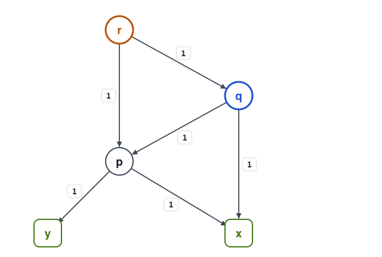
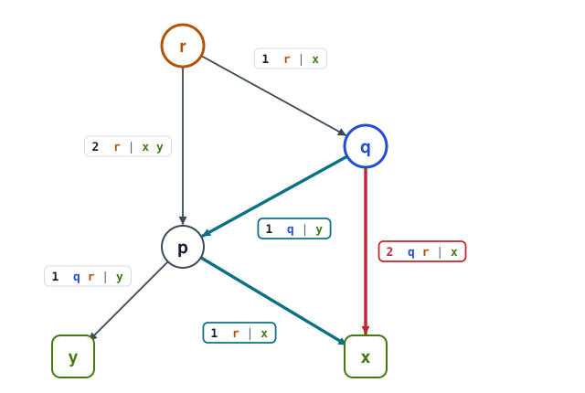
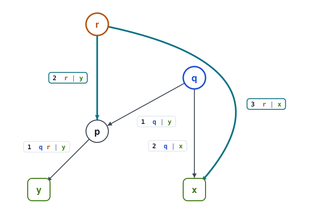
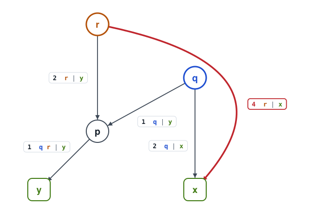

# How the New Factoring Works

FastDifferentiation computes derivatives by drawing an expression as a network
and adding up products along routes through it. To keep that cheap, it first
simplifies the network: wherever several routes run between the same two
points, it replaces them with one shortcut whose value is their total. This
branch changes how each shortcut is built. This document explains the new
procedure from the beginning, using the smallest expression on which the old
procedure returns a wrong derivative.

Every term with a meaning specific to this algorithm is in **bold** where it is
first used and is defined in that sentence.

## The example

```julia
using FastDifferentiation
@variables x y
p = x + y
q = x + p
r = p + q
jacobian([q, r], [x, y])
```

| derivative | correct | `main` | this branch |
|:--|--:|--:|--:|
| ∂q/∂x | 2 | 2 | 2 |
| ∂q/∂y | 1 | 1 | 1 |
| ∂r/∂x | 3 | **4** | 3 |
| ∂r/∂y | 2 | 2 | 2 |

Written out, q = 2x + y and r = 3x + 2y, so the correct Jacobian is
`[2 1; 3 2]`. On `main` the call returns 4 for ∂r/∂x, with no error or warning.
Three additions and two inputs are enough to trigger the bug, and nothing
smaller does. [Section 9](#9-how-the-example-was-found) describes the search
that established this.

## 1. The derivative graph

FastDifferentiation represents the expression as a **derivative graph**, a
drawing with one circle for each input and each operation, and one line from
every operation down to each of its operands. Each circle is a **node**. Each
line is an **edge**, and it joins an **upper node**, the operation, to a
**lower node**, the operand.

Every edge has a **value**, which is the partial derivative of its upper node
with respect to its lower node. For p = x + y, ∂p/∂x = 1 and ∂p/∂y = 1, so both
edges below p have value 1. Every operation in the example is an addition, so
every edge starts with value 1.

The **roots** are the nodes whose derivatives are requested, here q and r. The
**variables** are the inputs, here x and y. A **path** is a chain of edges that
starts at a root and goes downward, one edge at a time, until it reaches a
variable. The **path product** of a path is the product of the values of its
edges.

By the chain rule, the derivative of a root with respect to a variable is the
sum of the path products of all paths between them. Here every value is 1, so
each derivative is just the number of paths:



*Figure 1. The derivative graph, roots at the top and variables at the bottom.
Each edge is labelled with its value.*

| derivative | paths | sum |
|:--|:--|--:|
| ∂q/∂x | q→x, q→p→x | 2 |
| ∂q/∂y | q→p→y | 1 |
| ∂r/∂x | r→p→x, r→q→x, r→q→p→x | 3 |
| ∂r/∂y | r→p→y, r→q→p→y | 2 |

In larger graphs the number of paths grows exponentially, and many derivatives
share long stretches of the same paths. Factoring, which merges a bundle of
paths between two nodes into single edges ahead of time (made precise in
section 3), removes this repeated work.

The code also gives every node a **postorder number**, chosen so that each
node's number is larger than the numbers of all nodes below it: x = 1, y = 2,
p = 3, q = 4, r = 6. Numbers 5 and 7 belong to do-nothing wrapper nodes
(`NoOp`) that the code places above each root. They change nothing in this
example, so the figures leave them out.

## 2. Masks: which edge serves which derivative

Factoring rewires the graph, and afterwards the code still has to know which
edges belong to which derivative. It records this on every edge with two
**masks**, which are sets of names stored as bit vectors:

- the **root mask** (`reachable_roots`), a set of roots;
- the **variable mask** (`reachable_variables`), a set of variables.

An edge **carries** a root if that root is in its root mask, and carries a
variable if that variable is in its variable mask. A **pair** is one root
together with one variable, such as (r, x), and an edge carries a pair if it
carries both of its names. When the graph is built (`initialize_edge_masks!`),
an edge's root mask is the set of roots above it and its variable mask is the
set of variables below it.

A path is **live** for a pair if every edge on it carries that pair. From here
on, the derivative for a pair is the sum of path products over the paths that
are live for that pair. Factoring adds edges and removes names from masks, and
it is correct only if none of these sums changes.

In the figures, an edge label such as `1  q r | x y` means value 1, root mask
{q, r}, variable mask {x, y}.


*Figure 2. The graph with its starting masks. Edges below q carry both roots,
because both q and r lie above them. Edges leaving r carry only r.*

## 3. What gets factored

Factoring works on **factorable subgraphs**, which are pairs of nodes between
which two or more paths run for the same root or the same variable. There are
two kinds.

A **dominator subgraph** [A, B] has A above B. It is found for a root f when
every path from B up to f passes through A, A is the closest node to B with
that property, and B has at least two edges going up toward f.

A **postdominator subgraph** [A, B] is the mirror image, with A below B. It is
found for a variable v when every path from B down to v passes through A, A is
the closest node to B with that property, and B has at least two edges going
down toward v.

In both kinds, A is the **dominating node** and B is the **dominated node**. A
subgraph's **dominance mask** is the set of names it was found for: roots for a
dominator subgraph, variables for a postdominator subgraph. Its
**non-dominance mask** holds names of the other kind, as they stood when the
subgraph was found: the variables below B for a dominator subgraph, or the
roots above B for a postdominator subgraph. For an edge, the same words pick
out one of its two masks. In a dominator subgraph an edge's dominance mask is
its root mask and its non-dominance mask is its variable mask; in a
postdominator subgraph it is the other way round.

A **segment** of a subgraph is a chain of edges that runs downward from one of
its two nodes to the other: from A down to B in a dominator subgraph, or from B
down to A in a postdominator subgraph. To **factor** a subgraph is to replace
its segments with direct edges between A and B, whose values are sums of
segment products, and to edit masks so that the old segments stop being live
for the pairs the new edges take over.

The code finds every factorable subgraph before changing anything
(`compute_factorable_subgraphs`), and then factors them one at a time
(`factor!`). Subgraphs whose two postorder numbers are closer together go
first, and ties go to the subgraph that more root–variable pairs pass through.
In the example the order is:

| step | subgraph [A, B] | kind | found for | dominance mask | non-dominance mask |
|:--:|:--|:--|:--|:--|:--|
| 1 | [r, p] | dominator | root r | {r} | {x, y} |
| 2 | [x, q] | postdominator | variable x | {x} | {q, r} |
| 3 | [p, r] | postdominator | variable y | {y} | {r} |
| 4 | [q, x] | dominator | root q | {q} | {x} |
| 5 | [r, x] | dominator | root r | {r} | {x} |
| 6 | [x, r] | postdominator | variable x | {x} | {r} |

For example, [x, q] is a postdominator subgraph because every path from q down
to x ends at x, and q has two edges going down toward x: q→x and q→p.

## 4. How one subgraph is factored now

The new `factor_subgraph!` has five parts. Every part reads the masks as they
are at that moment, after all earlier steps. The subgraph's own masks, which
were recorded before any factoring, only limit which pairs the step handles.

### Part 1. The region (`subgraph_region`)

A **forward edge** of a node is an edge that leaves it in the direction of A:
an upward edge in a dominator subgraph, a downward edge in a postdominator
subgraph. The **region** of the subgraph is the set of nodes the code reaches
by starting at B and following forward edges, using only edges that carry at
least one name from each of the subgraph's two masks, and stopping at A. It is
the inside of the subgraph plus A. The code records the region first, because
Part 4 changes edges at B.

### Part 2. Groups of segments (`subgraph_path_groups`)

Each segment gets two masks of its own. Its **segment dominance mask** is the
subgraph's dominance mask intersected with the dominance masks of all the
segment's edges. Its **segment non-dominance mask** is formed the same way
from non-dominance masks. A segment carries exactly the pairs made of one name
from each of these two masks, because those are the pairs every one of its
edges carries.

A **group** is a set of segments whose two segment masks are identical and both
non-empty. For each group the code keeps the two masks, the sum *V* of its
segments' path products, and the number *n* of its segments. Segments with an
empty segment mask carry no pair the subgraph handles, and belong to no group.

The number of segments can grow exponentially, so the code never lists them.
Instead it gives each region node u a **table** G(u), which maps a pair of
masks (Dm, Nm) to the sum V of the products and the number n of the chains of
edges between u and the upper of the two nodes that have exactly those masks
(computed as for segments). For a dominator subgraph the upper node is A:

```
G(A) = { (dominance mask of S, non-dominance mask of S) ↦ (V = 1, n = 1) }

G(u) = for each forward edge e of u, with w its upper node,
         for each entry (Dm, Nm) ↦ (V, n) of G(w):
           key = (dominance mask of e ∩ Dm, non-dominance mask of e ∩ Nm)   -- skipped if either is empty
           add V · value(e) and n to G(u)[key]
```

The groups are the entries of G(B). Each table is computed once (memoized), so
the work is proportional to the number of region edges times the number of
distinct mask pairs, not to the number of segments. For a postdominator
subgraph the upper node is B, and the same tables are pushed downward from B
to A, one region node at a time in topological order. In both cases every
product is formed from the upper node downward, the same order `follow_path`
uses, so that products can be shared. [Section 11](#11-appendix-how-the-group-tables-are-computed)
explains this dynamic program in detail.

### Part 3. Blocks and replacement edges (`index_classes`, `factored_edges`)

A pair belongs to every group whose two masks contain its two names, so its
correct new value is the sum of *V* over those groups. Different pairs can
belong to different sets of groups, so the code sorts the pairs into blocks.

A **row class** is a largest set of dominance names that lie in exactly the
same groups' segment dominance masks. A **column class** is the same thing for
non-dominance names and segment non-dominance masks. A **block** is one row
class combined with one column class: all the pairs made of one name from
each. The block's **cover** is the set of groups that contain the block. Every
pair in a block lies in exactly the groups of its cover. One edge per group
would not work, because a pair that lies in two groups would then get two
parallel edges and be counted twice.

`index_classes` finds the classes by refining one mask at a time. Its cost
depends on the number of groups and classes, never on the total number of
roots or variables:

```
classes = [(signature 0…0, every name in some mask)]
for k in 1:number of groups
    replace each (σ, I) in classes by
        (σ with σ[k] = 1,  I ∩ mask k)   if non-empty
        (σ,                I \ mask k)   if non-empty
```

The **signature** σ of a class records which groups' masks contain it, so the
cover of a block is the bitwise AND of its row and column signatures.

Each block with a non-empty cover becomes one **replacement edge** between A
and B. Its value is the sum of *V* over the cover, its dominance mask is the
row class, and its non-dominance mask is the column class. If every block's
cover holds fewer than two segments in total, no pair has more than one
segment, and the step changes nothing.

### Part 4. Detaching the old segments (`add_non_dom_edges!`, `reset_edge_masks!`)

Before it adds a replacement edge, the code takes that edge's pairs off the
old segments. A **boundary edge** of a block is a forward edge of B whose
dominance mask contains the whole row class and whose non-dominance mask
shares at least one name with the column class. Every segment that carries a
pair of the block starts with a boundary edge. For each block, in turn, the
code:

1. splits every boundary edge that also carries dominance names outside the
   row class. To **split** an edge is to replace it with two copies that have
   the same value: one copy keeps only the row class's dominance names, and
   the other keeps the remaining dominance names and all of the original
   non-dominance names;
2. removes the column class from the non-dominance mask of each boundary edge
   that now holds just the row class;
3. deletes every edge whose mask became empty;
4. adds the replacement edge.

Blocks are disjoint, so a later block's boundary test never matches an earlier
block's replacement edge. Only edges at B are changed here. Edges further
inside may still be used by paths that never pass through B.

### Part 5. Pruning (`prune_stale_masks!`)

After Part 4, an edge inside the region can still carry names whose only way
onward was a boundary edge that lost them. **Pruning** removes such names. For
an edge inside the region, its **continuations** are the edges that leave its
B-side end moving away from A and still carry something. The code keeps a
non-dominance name on the edge, for a given dominance name, only if some
continuation carries both. If different dominance names keep different sets,
the edge is split. It works outward from B, so each continuation has already
been pruned before it is consulted. Later steps rely on these masks being
exact.

## 5. The example, step by step

In the figures below, teal and purple mark the first and second segment of
the subgraph being factored, a dashed ring marks the dominating node and a
solid ring the dominated node, teal labels mark edges added or changed by the
step, red marks an edge that is wrong, and grey edges take no part in the
step.

### Step 1: dominator subgraph [r, p] (main and this branch agree)

![Figure 3. The two segments of [r, p]: r→p, and r→q→p.](img/fig-step1.svg)

*Figure 3. Every path from p up to root r ends at r, and p has two edges going
up that carry r. The two segments are r→p and r→q→p.*

- **Region:** starting at p and following upward edges gives {q, r}.
- **Groups:** both segments carry {r} × {x, y}, so there is one group with
  *V* = 1 + 1·1 = 2 and *n* = 2.
- **Blocks:** one row class {r} and one column class {x, y}, so one
  replacement edge r→p with value 2 and masks `r | x y`.
- **Detaching:** the boundary edges are the upward edges of p, r→p and q→p.
  q→p also carries q, so it is split into a q copy and an r copy. The r copy
  and the old r→p lose {x, y}, become empty, and are deleted. What remains is
  q→p with `q | x y`.
- **Pruning:** r→q carried y only so that r could reach y through q→p. Its
  continuations are q→x (`q r | x`) and q→p (`q | x y`). Only q→x carries r,
  and it carries only x, so r→q becomes `r | x`.


*Figure 4. After step 1. q→p no longer carries r, and r→q no longer carries y.*

Check: ∂r/∂x now has live paths r→p→x (2·1) and r→q→x (1·1), which give 3 as
before. The important change for what follows is that the path q→p→x is no
longer live for r, because r's share of it now travels on the value-2 edge
r→p.

### Step 2: postdominator subgraph [x, q] (main goes wrong here)

![Figure 5. The two segments of [x, q]: q→x carries roots q and r; q→p→x carries only root q.](img/fig-step2.svg)

*Figure 5. The subgraph's masks, recorded before step 1, say that both
segments serve roots {q, r}. After step 1, only q→x still carries r.*

- **Region:** starting at q and following downward edges that carry x gives
  {p, x}.
- **Groups:** the segments now have different segment masks, so there are two
  groups:

| group | segment | segment dominance mask | segment non-dominance mask | *V* | *n* |
|:--|:--|:--|:--|--:|--:|
| G1 | q→x | {x} ∩ {x} = {x} | {q,r} ∩ {q,r} = {q, r} | 1 | 1 |
| G2 | q→p→x | {x} ∩ {x,y} ∩ {x} = {x} | {q,r} ∩ {q} ∩ {q,r} = {q} | 1 | 1 |

- **Blocks:** the only dominance name is x, and it lies in both groups, so
  there is one row class {x}. The non-dominance names split by group
  membership: q lies in G1 and G2, and r lies only in G1. That gives two
  column classes and two blocks:

| | {q}: in G1, G2 | {r}: in G1 |
|:--|:--|:--|
| **{x}**: in G1, G2 | cover {G1, G2}, value 1 + 1 = **2** | cover {G1}, value **1** |

On `main`, factoring a subgraph always made one edge whose value was the sum
over all segments and whose masks were the subgraph's original masks:



*Figure 6a (`main`). One edge, value 1 + 1 = 2, masks `q r | x`. For r, the live
paths to x are now r→q→x = 1·2 and r→p→x = 2·1, which sum to 4. The
contribution of q→p→x to r is counted twice: once inside the step 1 edge r→p,
and again inside this edge.*

The new code makes one edge per block:


*Figure 6b (this branch). Value 2 for q and value 1 for r. For r, the live paths
to x are r→q→x = 1·1 and r→p→x = 2·1, which sum to 3.*

- **Detaching, block {x} × {q}:** the boundary edges are q→x (`q r | x`) and
  q→p (`q | x y`). q→p also carries y, outside the row class, so it is split
  into an x copy and a y copy. Removing q empties the x copy, so it is
  deleted, and leaves q→x with `r | x`. Then the value-2 edge is added.
- **Detaching, block {x} × {r}:** the only boundary edge is now q→x
  (`r | x`). Removing r empties it, so it is deleted, and the value-1 edge is
  added.
- **Pruning:** p→x carried q for the path q→p→x, but q→p no longer carries x.
  Its only continuation that carries x is r→p, which carries only r, so p→x
  becomes `r | x`.

`main`'s single edge is correct only if every segment still carries every pair
in the subgraph's original masks. Step 1 took r off the segment q→p→x, so the
single edge hands r a contribution that r already receives through r→p.

### Steps 3 and 4: nothing left to merge

Step 3, [p, r] for variable y: after step 1 only r→p carries y out of r, so
there is a single segment. Step 4, [q, x] for root q: after step 2 only the
value-2 edge q→x carries q into x. In both steps every block covers just one
segment, so Part 3 reports nothing to do.

### Step 5: dominator subgraph [r, x]

![Figure 7. The segments of [r, x] on this branch: r→q→x through the value-1 edge, and r→p→x.](img/fig-step5.svg)

*Figure 7. On this branch, the segments for r are r→q→x through the value-1
edge, and r→p→x. The value-2 edge carries only q, so its segment mask for r is
empty and it is in no group.*

There is one group, *V* = 1·1 + 2·1 = 3, *n* = 2, so one replacement edge r→x
with value 3. Detaching deletes the boundary edges q→x (value 1) and p→x.
Pruning then deletes r→q, which no longer leads anywhere for r, and trims r→p
to `r | y`.



*Figure 8 (this branch). The final graph.*

On `main`, step 5 sums r→q→x = 1·2 and r→p→x = 2·1 and writes r→x with value
4. Step 6, [x, r], finds that r has only one edge going down toward x, and
does nothing on either version.



*Figure 9 (`main`). The same shape, but r→x has value 4.*

## 6. Reading off the derivatives (`follow_path`)

After factoring, each pair has at most one live path, and the derivative is
that path's product. `follow_path` finds it by walking down from the root,
always taking the one edge that carries the pair, and multiplies the edges in
decreasing order of how many pairs use them, so that shared products are
formed once. If it ever meets two candidate edges or a dead end, it falls back
to `sum_all_paths`, which adds up every live path, instead of asserting as
`main` did.

| pair | live path on this branch | this branch | `main` |
|:--|:--|--:|--:|
| (q, x) | q→x | 2 | 2 |
| (q, y) | q→p→y = 1·1 | 1 | 1 |
| (r, x) | r→x | 3 | 4 |
| (r, y) | r→p→y = 2·1 | 2 | 2 |

## 7. Why each step preserves every derivative

Fix one step, factoring subgraph S = [A, B], and one pair. The argument uses
the property S was found with: for a dominator subgraph, every path from B up
to a root in S's dominance mask passes through A, and the mirror image for a
postdominator subgraph.

- **Some segment carries the pair** (within S's masks). Then the pair lies in
  some group, so it is in a block with a non-empty cover. Every live path
  through B for the pair splits uniquely into a part above the subgraph, a
  segment carrying the pair, and a part below it. Summing over these paths
  gives (sum over upper parts) × (sum of *V* over the cover) × (sum over lower
  parts). The replacement edge has value equal to the sum of *V* over the
  cover and carries the pair, so the new paths through it have the same sum.
  Every segment carrying the pair starts with a boundary edge of the block,
  which loses the pair in Part 4, so none of the old paths stays live.
- **No segment carries the pair.** No block with a non-empty cover contains
  it, so no replacement edge carries it, and Part 4 removes no name of it:
  the copies it edits keep only the row class, and only the column class is
  removed from them.
- **Paths that do not pass through B** are touched only by pruning, which
  removes a name only if no continuation carries it with the same dominance
  name, so no live path is broken.

So each step preserves every derivative, and so does `factor!`. `main` breaks
the first point: its single replacement edge has the sum over all segments and
the subgraph's original masks, so it can carry a pair with a value that
includes segments which no longer carry that pair.

## 8. Cost

Let *n* be the size of S's dominance mask and *m* the size of its
non-dominance mask. A **mask operation** is an AND, comparison or hash of one
mask, which takes time proportional to the number of roots or variables
divided by the machine word size.

- **Groups.** Each key of a table G(u) is a pair of non-empty subsets of the
  *n* dominance and *m* non-dominance names, and each chain of edges from u to
  the upper node contributes one key. So |G(u)| ≤ min(P(u), (2ⁿ − 1)(2ᵐ − 1)),
  where P(u) is the number of those chains, and computing all tables takes at
  most the sum of |G(w)| over the region edges (u, w) in mask operations. For
  arbitrary masks the exponential bound is reached, for example by *n* + *m*
  diamonds in series, each dropping one name on one of its two branches.
- **Masks as built by `initialize_edge_masks!`** make every table have one
  entry. Every region node lies on a path between A and B, so every edge's
  masks contain S's masks. Different mask pairs arise only from edges that
  earlier factoring steps edited. No polynomial bound in *n* and *m* is known
  for those.
- **Blocks.** Row classes are disjoint non-empty sets of the *n* dominance
  names, so there are at most *n* of them, and at most *m* column classes.
  With *g* groups, `index_classes` takes O(*g*·(*n* + *m*)) mask operations,
  and there are at most *n*·*m* blocks, hence at most *n*·*m* replacement
  edges.

Measured just before each step of `factor!` by
[`scripts/measure_groups.jl`](scripts/measure_groups.jl):

| problem | steps | max groups at B | max \|G(u)\| | (*n*, *m*) where max occurs |
|:--|--:|--:|--:|:--|
| worked example (this document) | 6 | 2 | 2 | (1, 2) |
| gradient of Rosenbrock, 60 variables | 235 | 1 | 1 | (1, 1) |
| gradient of Σ sin(xᵢxᵢ₊₁)·exp(xᵢ), 40 variables | 467 | 1 | 1 | (1, 1) |
| dense map xᵢ·sin(Σⱼ xⱼ(i+j)/20), 20 in, 20 out | 40 | 1 | 1 | (1, 1) |
| random graph 1 (8 in, 8 out, 70 shared ops) | 128 | 4 | 4 | (1, 3) |
| random graph 2 | 94 | 6 | 6 | (1, 6) |
| random graph 3 | 155 | 6 | 6 | (3, 3) |
| random graph 4 | 198 | 4 | 4 | (1, 8) |

Random graph 1 has 4 groups with *n* = 1, *m* = 3, so the number of groups is
not bounded by *n*·*m*.

## 9. How the example was found

To find the smallest failing input, a script built every expression with up
to three binary operations (+, −, ×) on up to three variables, using every
variable at least once. For each expression it tried every non-empty set of
operation nodes as roots, in every order, and compared the Jacobian from
`main` with exact forward-mode derivatives at random points: about 139,000
expression-and-root combinations.

- No expression with one or two operations fails.
- With three operations, 128 expressions fail. They are exactly the
  expressions of the shape `a = x ∘ y; b = w ∘ a; c = a ∘ b`, where each ∘ is
  +, × or − (with either operand first) and w is x or y. Each fails only when
  both b and c are roots.
- No single-root expression with three or fewer operations fails. The
  smallest single-root failures have four additions, for example
  `p = x + y; q = x + p; s = z + p; t = q + s`, where `main` returns
  ∂t/∂x = 4 instead of 3.

The example in this document is the all-addition member of the
three-operation family, chosen because every edge value is 1 and each
derivative is a count of paths. This branch returns the correct Jacobian for
every one of these cases and for the four-addition single-root example. The
random-graph tests in [`test/random_graphs.jl`](test/random_graphs.jl) check
the same property on larger graphs.

## 10. Other changes on this branch

- **Read-out.** `follow_path` falls back to `sum_all_paths` instead of
  asserting when it finds a branch or a dead end (section 6).
- **Mask initialization.** `initialize_edge_masks!` computes, for every node,
  the roots above it (in reverse postorder) and the variables below it (in
  postorder), and gives each edge the roots of its upper node and the
  variables of its lower node.
- **Idempotent construction.** The `DerivativeGraph` constructor unwraps a
  root that is already a `NoOp` wrapper before wrapping it, so rebuilding a
  graph from existing roots keeps the same numbering.

## 11. Appendix: how the group tables are computed

Part 2 of section 4 needs, for every distinct pair of segment masks, the sum
*V* of the path products and the number *n* of the segments that have those
masks. This appendix explains how `subgraph_path_groups` gets them without
listing segments, using dynamic programming, and works through the two
subgraphs of the example that need it.

### Why the segments cannot simply be listed

The number of segments can grow exponentially with the size of the subgraph.
Put *k* diamonds in a row. Each diamond is a node with edges down to two
different nodes, and both of those have an edge down to the same next node,
where the next diamond starts. A segment through them picks one of two sides
in every diamond, so there are 2ᵏ segments, although the region has only 4*k*
edges. Listing them would make factoring exponential in the depth of the
graph.

### The fact that makes merging safe

Within this appendix, a **chain** is a sequence of edges that starts at the
upper of the subgraph's two nodes and goes downward one edge at a time,
inside the region. A segment is a chain that ends at the lower of the two
nodes. Every chain has the same three quantities a segment has: a pair of
masks (the subgraph's masks intersected with the masks of all its edges), a
product of edge values, and a count, which is 1 for a single chain.

Extending a chain by one more edge *e* changes these quantities in a way that
depends only on their current values and on *e*:

```
new masks = (Dm ∩ dominance mask of e,  Nm ∩ non-dominance mask of e)
new value = V · value(e)
```

So two chains that end at the same node and have the same masks will have the
same masks as each other after any further extension, whatever route each
took to get there. Their values also stay combinable, because multiplication
distributes over addition: V₁·value(e) + V₂·value(e) = (V₁ + V₂)·value(e).
Two such chains can therefore be replaced by a single entry that holds the sum
of their values and the sum of their counts, and every later result is the
same as if they had been kept apart. This is what lets the code merge chains
early instead of carrying each one separately.

A chain whose masks have become empty can be dropped. Intersection only
removes names, so its masks stay empty, and an empty mask means the chain
carries no pair the subgraph handles.

### The dynamic program

The **upper end** of the subgraph is A for a dominator subgraph and B for a
postdominator subgraph; the **lower end** is the other node. Chains start at
the upper end, and segments end at the lower end.

- **State.** For every node u, the table G(u) maps a pair of masks (Dm, Nm) to
  the sum V of the products and the number n of the chains that end at u and
  have exactly those masks.
- **Base case.** G(upper end) = { (dominance mask of S, non-dominance mask of S)
  ↦ (V = 1, n = 1) }. The single entry stands for the chain with no edges,
  whose masks are the subgraph's own.
- **Recurrence.** For every node u below the upper end, G(u) collects one
  contribution for each edge *e* that enters u from above, from a node w:
  every entry (Dm, Nm) ↦ (V, n) of G(w) is extended by *e* as shown above and
  added into G(u). Entries that land on the same masks are summed. Entries with
  an empty mask are dropped.
- **Answer.** The entries of G(lower end) are the groups.

Only edges that pass `on_subgraph_path` (Part 1) are followed. This is purely a
shortcut: an edge that shares no name with one of the subgraph's masks would
make that mask empty, and the entry would be dropped anyway.

### Order of evaluation

A table can be computed only after the tables of all nodes directly above it.
The two kinds of subgraph meet this requirement in different ways.

- **Dominator subgraph** (the method `subgraph_path_groups(subgraph, node, memo)`).
  The upper end is A. The code starts at B and asks for G(B). To compute a
  table it asks for the tables at the upper ends of its node's upward edges,
  recursively, until it reaches A, which returns the base case. Each table is
  stored in the dictionary `memo` the first time it is computed, so no table
  is computed twice, however many chains pass through its node.
- **Postdominator subgraph** (the method `subgraph_path_groups(subgraph, region)`).
  The upper end is B. The code starts with the base case at B and visits B and
  the region nodes in decreasing postorder number. Every edge goes from a
  higher number to a lower one, so this visits each node only after every node
  above it. At each node it pushes the node's table down along each downward
  edge into the table of the node below.

The postdominator case could also have been written as a recursion that
starts at B. That recursion would describe chains from each node down to A,
and would form each product starting from the bottom. Pushing tables downward
instead forms every product in both kinds starting from the upper end, in the
same order that `follow_path` uses. FastDifferentiation stores each distinct
expression only once, so products built in the same order can be reused
between the factoring step and the read-out.

### Step 1, table by table

![Group tables for step 1, the dominator subgraph [r, p]. G(r) = r | x y, V=1, n=1. G(q) = r | x y, V=1, n=1. G(p) = r | x y, V=2, n=2.](img/fig-dp-step1.svg)

*Figure 10. The tables for step 1, the dominator subgraph [r, p]. For
readability, every mask pair is written the same way as an edge label: root
mask, then variable mask. In the code, the key of a dominator subgraph is
(root mask, variable mask) and the key of a postdominator subgraph is
(variable mask, root mask).*

The upper end is r, so G(r) is the base case: the subgraph's masks {r} and
{x, y}, with V = 1 and n = 1.

G(q) has one upward edge to follow, r→q (`r | x y`). Extending the entry of
G(r) by it gives masks {r} ∩ {r} = {r} and {x, y} ∩ {x, y} = {x, y}, and value
1·1 = 1. q's other upward edge, from the wrapper node above the root q,
carries only root q. Its root mask shares nothing with {r}, so it is not
followed.

G(p) has two upward edges. Through r→p (`r | x y`), the entry of G(r) becomes
`r | x y` with V = 1·1 = 1. Through q→p (`q r | x y`), the entry of G(q) becomes
{r} ∩ {q, r} = {r} and {x, y}, with V = 1·1 = 1. The two results have the same
masks, so they merge into one entry with V = 1 + 1 = 2 and n = 2. This is the
single group of step 1.

### Step 2, table by table

![Group tables for step 2, the postdominator subgraph [x, q]. G(q) = q r | x. G(p) = q | x. G(x) has two entries: q r | x and q | x, each with V=1, n=1.](img/fig-dp-step2.svg)

*Figure 11. The tables for step 2, the postdominator subgraph [x, q], computed
on the masks left by step 1.*

The upper end is q, so G(q) is the base case: variables {x} and roots {q, r}.
The code visits q (postorder number 4) and then p (number 3).

Visiting q pushes along its two downward edges. Along q→x (`q r | x`), the
entry keeps its masks, `q r | x`, and arrives in G(x) with V = 1. Along q→p
(`q | x y`), the roots shrink to {q, r} ∩ {q} = {q} and the variables to
{x} ∩ {x, y} = {x}, so G(p) receives `q | x` with V = 1.

Visiting p pushes along p→x (`q r | x`): {q} ∩ {q, r} = {q} and {x} ∩ {x} = {x},
so G(x) receives `q | x` with V = 1. This key differs from the entry already in
G(x), so the two are not merged. The other downward edge of p, p→y, carries
only variable y, which shares nothing with {x}, so it is not followed.

G(x) ends with two entries, which are the two groups of step 2. Keeping them
apart is the point of the new algorithm: the chain through p no longer carries
root r, and `main`, which added both segments into one edge for both roots,
lost exactly that information.

### Cost

Each entry of each table is extended once along each edge leaving its node,
so computing all tables takes one mask operation per (table entry, edge)
combination: the sum of |G(u)| over the region edges leaving u. When the masks
are as `initialize_edge_masks!` built them, every table has one entry (section
8), and the work grows linearly with the number of region edges. For the *k*
diamonds above that is 4*k* extensions instead of 2ᵏ segments. Tables grow
only when earlier factoring steps have given different edges different masks,
as in step 2, and section 8 gives the worst-case bound.

### In the code

- `PathGroups` is the type of a table: a `Dict` from a pair of mask keys to a
  tuple (dominance mask, non-dominance mask, V, n). V is a FastDifferentiation
  expression, not a number, so the factored graph computes the sum symbolically.
- `mask_key` uses a mask's `chunks`, its underlying `UInt64` words, as the
  dictionary key. Hashing a `BitVector` directly goes element by element and
  is much slower.
- `factored_edges` calls the dominator method with B and an empty `memo`, or
  the postdominator method with the region, and collects the entries of the
  returned table as the groups.

The read-out fallback `sum_all_paths` (section 6) uses the same idea in its
simplest form. It stores, for each node, the sum of path products from that
node down to the variable, over paths that carry the pair. Each node's sum is
the sum, over its downward edges that carry the pair, of the edge value times
the stored sum of the node below. Each node is computed once.

The figures are generated, and checked against the code, by
[`img/generate_figures.jl`](img/generate_figures.jl).
