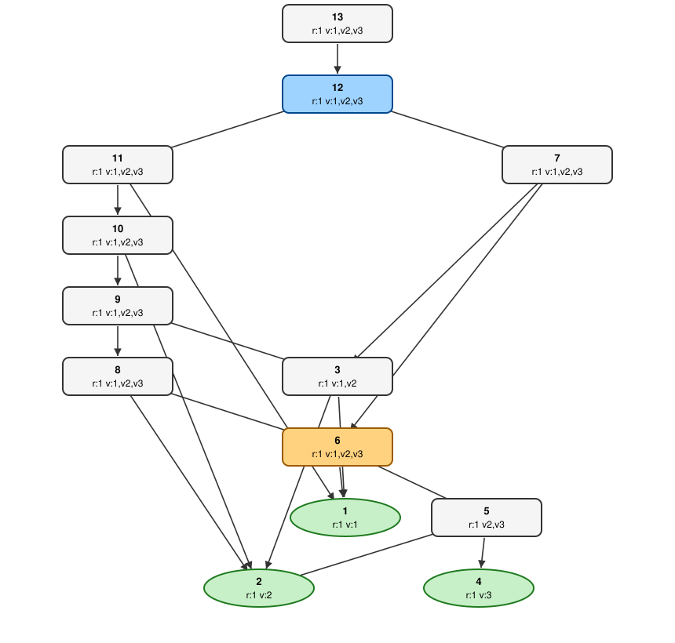
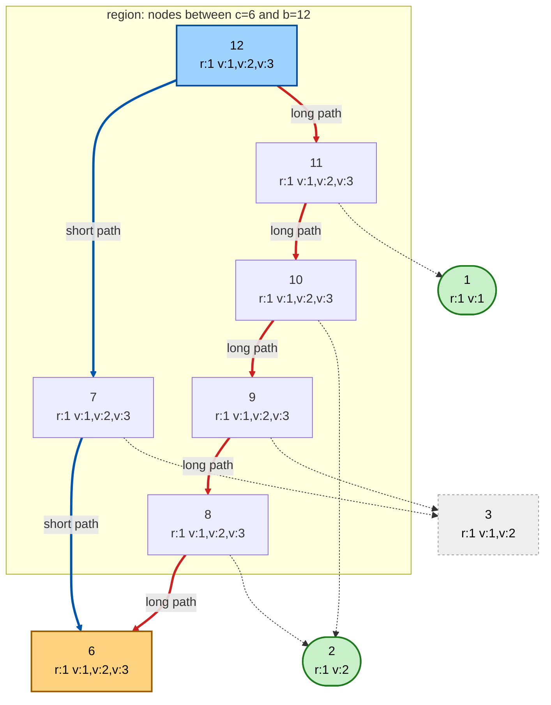
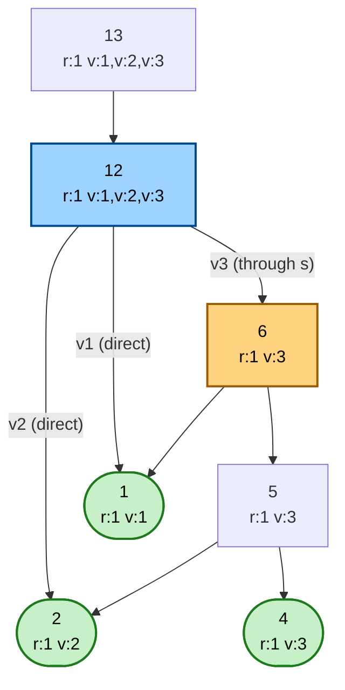

# How the Factorization Fix Works

This document explains, in plain language backed by a real traced example, what was
wrong with factorization on `main`, how the new algorithm on this branch fixes it,
and why the fix is actually correct — not just "passes the tests we happened to
write." This branch makes the minimum change needed to fix factorization: the
functions described below, in `src/DerivativeGraph.jl`, `src/FactorableSubgraph.jl`,
and `src/Factoring.jl`, plus the code in those same files (and in
`src/GraphProcessing.jl`) that the fix leaves with no remaining caller, which is
removed along with it. A regression test (`test/test-complex-expressions.jl`) covers
the issues below, and `test/test-differentiation-interface.jl` runs the broader
`DifferentiationInterfaceTest` scenario suite against this branch.

---

## 1. What "factoring" is actually doing

FastDifferentiation computes a derivative by building a DAG — the **derivative
graph** — where each edge holds a local partial derivative, and the value of
`∂fᵢ/∂xⱼ` is the sum, over every directed path from root (output) `i` down to
variable (input) `j`, of the product of the edge values along that path:

```
f_ij = Σ_{paths π : root i → variable j}  ∏_{edges e ∈ π} value(e)
```

Naively evaluating this sum by enumerating every path is exponential. **Factoring**
rewrites the graph so that a group of paths which share structure gets evaluated
once instead of once per path — the symbolic equivalent of noticing `ac + ad =
a(c+d)`. Concretely: whenever there's a node `b` that dominates a node `c` (every
path from `c` up to some set of roots passes through `b`), the whole tangle of
paths between `b` and `c` can be collapsed into a single new edge whose value is
the sum of those internal paths, and the old internal edges can be deleted.

The entire correctness obligation of factoring is: **after replacing `[b,c]` with
new edges, `f_ij` must come out exactly the same for every `(i,j)`.** Only the
*number of multiplications needed to compute it* is allowed to change.

In a single-input/single-output graph this is straightforward — there's only one
`(i,j)` pair, so "the subgraph's value" is unambiguous. The entire branch is about
making this work when a node inside `[b,c]` is reachable from *some but not all* of
the roots, or leads to *some but not all* of the variables — which is the normal
case once a graph has more than one output or more than one input and shares
structure between them.

---

## 2. A real example, traced end to end

This is a reduction of GitHub issue #23 — simplified further by collapsing every
node that has exactly one edge in and one edge out (a plain unary wrapper like
`cos(...)` sitting on a chain contributes nothing to *which nodes branch or
reconverge*, only to the arithmetic, so it can be dropped without touching the
topology that causes the bug). What's left is the smallest version of this graph
where every single non-leaf node has two children or two parents — nothing left to
remove. It's still verified end to end: confirmed to crash on `main` and to produce
the finite-difference-correct answer on this branch, with the actual internal
masks and path groups printed out.

### 2.1 The expression

```julia
using FastDifferentiation
@variables v1 v2 v3
vars = [v1, v2, v3]

d   = v2 - v3
s   = v1 * d
p   = v1 + v2
n12 = v2 + s
n10 = p + s
n15 = n12 * p
n16 = v2 + n15
n18 = n16 * v1
r1  = n10 + n18
```

`v1`, `v2`, `v3` are the three input variables and `r1` is the single output
(root), matching the `v:i`/`r:i` labels used in the masks and diagrams throughout
this document. `s` is computed once but used twice — directly inside `n10`, and
again (buried inside `n12`) on the way to `n18`. Those two uses reconverge only at
`r1` itself. That's the shape that creates a genuine factorable subgraph: a node
with two parents whose paths merge again further up the graph. `p` is shared the
same way (used by both `n10` and `n15`), which turns out to matter for *why* the
bug triggers, below.

### 2.2 Confirmed broken on `main`

```julia
j = jacobian([r1], vars)
```
```
ERROR: AssertionError: Should only be one path from root 1 to variable 2.
Instead have 2 children from node 12 on the path
```

`main` doesn't just compute a wrong number here — it crashes outright, because by
the time the answer is read out, the graph still has an unresolved fork where there
should be exactly one path left.

### 2.3 Confirmed correct on this branch

```
pt=[0.3, 0.7, 0.2]     symbolic=[ 3.455,  2.245, -0.39 ]    fd=[ 3.4549999999,  2.2450000000, -0.3899999999]
pt=[1.1,-0.5, 0.9]     symbolic=[-5.292,  2.342, -1.826]    fd=[-5.2919999995,  2.3419999999, -1.8260000003]
pt=[-0.8,0.4,-0.3]     symbolic=[ 2.516, -0.408,  1.056]    fd=[ 2.5160000001, -0.4079999999,  1.0559999999]
```

Agrees with central finite differences at every test point.

### 2.4 What the graph actually looks like

Postorder numbering, straight from `DerivativeGraph`'s own output (`v1`→1,
`v2`→2, `v3`→4):

```
3  = p  = v1 + v2        -- used by BOTH node 7 and node 9 below
5  = d  = v2 - v3
6  = s  = v1 * d           -- used by BOTH node 7 and node 8 below
7  = n10 = p + s
8  = n12 = v2 + s
9  = n15 = n12 * p
10 = n16 = v2 + n15
11 = n18 = n16 * v1
12 = r1  = n10 + n18
```

Node **6** (`s`) has two parents — the edge `7→6` and the edge `8→6` — and both
chains reconverge at **node 12** (`r1`). That's the factorable subgraph `[b=12,
c=6]`: a dominator subgraph, since node 12 is on every path from node 6 up to the
(single) root.

#### Diagram: the graph before factoring

Each box shows the node number and that node's own `reachable_roots` /
`reachable_variables` masks, written as `r:i` for each set root bit and `v:i` for
each set variable bit (a `0` bit contributes nothing to the label). There's only
one root in this example, so `r:1` appears on every node — that's expected, not a
mistake. Orange is the dominated node `c = 6` (two parents, both reachable up to
node 12); blue is the dominating node `b = 12` where those two parents
reconverge; green stadiums are the variable leaves.



Every non-leaf node here has exactly two children or two parents; there's nothing
left that's purely a pass-through link in a chain. Node 6 (`s`) has two parents,
`7` and `8`, and following either one upward eventually lands back on node 12 —
that round trip is the factorable subgraph. Node 3 (`p`) is *also* shared, by
nodes `7` and `9` — it doesn't trigger the bug on its own, but it's the reason the
bug triggers at node 6, as the next section shows.

Notice that nodes 6 through 13 all show the *identical* mask, `r:1 v:1,v:2,v:3` —
once a node's subtree reaches all three variables, its own aggregate mask can't
tell you anything more specific. That's exactly the problem the bug exploits:
despite every one of these nodes reporting the same aggregate mask, the *individual
paths* passing through them reach different, smaller subsets of variables — which
is precisely what the next section's masks (computed per-path, not per-node) make
visible.

### 2.5 Why the *old* algorithm broke here — concretely

The subgraph's variable mask (the union of every variable reachable from node 6)
is `[v1, v2, v3] = [1,1,1]`. But when `subgraph_path_groups` (the new code)
actually walks the two real paths from node 6 up to node 12, it finds they are
**not** the same:

```
path through node 7 (n10 = p + s):        non_dom_mask = [1, 0, 1]   (v1, v3 — no v2)
path through node 8→9→10→11 (n12→n15→n16→n18): non_dom_mask = [1, 1, 1]   (all three)
```

Neither path is individually what the subgraph's own stored mask says — one of
them is a strict subset. `main`'s old path-walking code (`old_edge_path`) filtered
candidate edges with

```julia
subset(reachable_mask, reachable_variables(edge))   # reachable_mask = [1,1,1], the WHOLE subgraph's union
```

i.e. it demanded that *each individual edge's own mask be a superset of the whole
subgraph's union mask*. The edge on the `node 7` path carries only `v1` and `v3`
— correct and genuine — and fails that test against `[1,1,1]`, so the path gets
rejected mid-walk. That's a real derivative term silently dropped, which is exactly
how the graph was left with node 12 still pointing at two unresolved children when
the final read-out ran — hence the assertion failure.

This is issue #23's failure mode, stated abstractly: single-variable paths get
rejected because the old code tested each edge against the union of all variables
reachable by the *entire* subgraph, rather than against what that specific path
actually carries. Here it is with real node numbers and real masks.

It's worth being precise about *why* the two paths end up with different masks at
all — node 6 (`s`) itself depends on all three variables, so you might expect
every edge on the way up from it to carry `[1,1,1]`. Tracing the real sequence of
`factor!` steps shows what happens: **exactly one** smaller, unrelated subgraph is
factored before `[12, 6]` is reached. Node 7 (`n10 = p + s`) has two children, `p`
and `s`, that *both* separately reach `v2` (`p = v1+v2` directly; `s` via `d =
v2-v3`) — so `[2, 7]` (collapse the two routes to `v2`) fires first, as step 1 of
the 14 steps `factor!` runs on this graph. That step splits the `v2` bit off the
`7→6` edge onto a brand-new direct edge from node 7 straight to variable `v2`,
because there were two routes into `v2` to collapse into one. Node 8 (`n12 =
v2+s`) has no such redundancy for `v2` (its only route to `v2` other than the
direct one *is* the direct one), and no sibling at all for `v1`, so nothing
touches the `8→...→6` chain before `[12, 6]`'s turn comes.

#### Diagram: the `[2, 7]` step that narrows edge `7→6`

This is the one step that runs before `[12, 6]`. The three pictures below are
not separately auto-laid-out diagrams that happen to look similar — all three,
plus "the graph before factoring" above, are rendered from one fixed table of
node coordinates, so every node sits at the exact same pixel position in every
picture it appears in. Nothing moves except what the picture is specifically
showing you.

First, the graph exactly as shown before, for reference:


Node 7 has two separate routes down to `2`: directly through `3` (`p`'s own
`+v2` term), and through `6`'s child `5` (buried inside `d`'s `v2-v3` term).
Two distinct paths from `7` down to `2` is exactly the postdominator pattern,
so `factor_subgraph!` finds `[b=2, c=7]` (`2` postdominates `7`) and factors it
— this is what runs first, before `[12, 6]`. Here is the same picture — same
file, even, not just the same layout reproduced by hand — with that subgraph's
two routes picked out in purple and boxed:


`factor_subgraph!` sums the two routes' contributions (`∂p/∂v2 = 1` and
`∂s/∂v2 = v1·∂d/∂v2 = v1`) into one new edge from `7` straight to `2`, and
clears the `v2` bit from *every* boundary edge leaving `7` that used to feed
that sum — both `7→3` and `7→6`, even though only `7→6` matters for `[12, 6]`.
Same picture again, every node in the same place, with only one addition — the
new edge, in purple:


Every node box is unchanged from the first picture in this section —
`reachable_variables`/`reachable_roots` are per-node aggregates, and node 7
reaches the same three variables either way, just through a different edge for
`v2` now. The change that matters for `[12, 6]` is invisible at the node level
and only shows up on the edge itself: `7→6`'s own `reachable_variables` goes from
`[1,1,1]` to `[1,0,1]`, because the new `7→2` edge carries the `v2` contribution
that used to be folded into it. This is the real output of `factor_subgraph!`,
not an illustration: the next section's computed node numbers, edge values, and
masks are all taken from running exactly this example.

By the time `[12, 6]` itself is processed (step 2 of 14), edge `7→6` has already
lost its `v2` bit to that one earlier step and carries only `v1` and `v3` —
hence the `[1,0,1]` path. Edge `8→6` was never touched and still carries
everything — hence the `[1,1,1]` path. The `[1,1,1]` printed as the subgraph's own
`reach_vars` is its mask *as recorded at discovery time*, before that one prior
step ran; `subgraph_path_groups` always re-derives its masks from the graph's
*current* edges when it actually runs, which is why it sees the already-shrunk
value on one side. This is a concrete instance of the order-independence argument
in [§3.6](#36-from-one-step-to-the-whole-algorithm): two unrelated factorable
subgraphs touch the same corner of the graph in a sequence baked in by the
priority heap, and each one only has to be locally correct — neither needs to know
about the other.

The old algorithm's mistake, regardless of this ordering, was the same one either
way: it compared the `node 7` path's edge against the subgraph's *whole* union
mask (`[1,1,1]`) instead of against what that specific path actually carries.

#### Diagram: the two real paths through the subgraph

This zooms into the "region" between `c = 6` and `b = 12` — the nodes
`subgraph_region` actually finds by walking parent edges upward from node 6. The
**blue, thick** edge is the short path (node `7`, mask `[1,0,1]`); the **red,
thick** edges are the long path (`8→9→10→11`, mask `[1,1,1]`). The **dashed**
edges are the *other* operand at each operation — e.g. node 9 is `n12 * p`, and
only the `n12` side is on a path back to node 6; `p` is a sibling input that never
touches node 6 at all, so it sits outside the region entirely, exactly like the
grayed-out nodes above.

(Those `[1,0,1]`/`[1,1,1]` figures are the *path groups'* masks — a property of
each specific route through the subgraph, computed below. They're different from
the per-node boxes in the diagram, which — same as the previous diagram — all
read the identical `r:1 v:1,v:2,v:3`, since every node in this region still has
the same aggregate reachability. The whole point of this section is that the
per-node view and the per-path view disagree, and the old algorithm only ever
looked at the per-node one.)



It's tempting to read the dashed edges at nodes 8 and 10 above (both landing on
`v2`) as "each node on the long path needs its own extra route to `v2`." That's
not actually it — I checked by replacing those dashed edges with a plain,
unrelated constant at every hop (so nothing downstream touches `v2` a second time
at all) and the crash on `main` was unaffected. What *is* load-bearing is simply
the **length** of the long path. With only one or two nodes between `s` and `r1`
instead of four, `main` gets the right answer — the bug doesn't appear at all. At
three nodes, `main` silently computes a *wrong* answer (a genuine bug, just a
quiet one — confirmed by hand, it has a spurious duplicated term). Only at four
nodes does it escalate to this unambiguous crash. The reason is `factor!`'s
processing order: subgraphs are popped off its heap by a priority number that
grows with the distance between a subgraph's two ends, so the `[r1, s]` subgraph
and the short path's `v2`-collapsing subgraph (`[2, 7]`, discussed above) race for
which one gets processed first — and the long path needs to be *this* long before
the race comes out the way that exposes the bug. So this example is already at the
node count where the failure is a clean, unmissable assertion rather than a subtle
numeric discrepancy you'd have to go looking for.

### 2.6 What the new algorithm does instead

`subgraph_path_groups` doesn't test an edge against the subgraph's *union* mask —
it only requires the edge to **overlap** the subgraph's mask (share at least one
relevant bit), and it tracks each *group* of paths by the exact pair of masks that
group's edges actually have in common, instead of lumping everything into one
union. The real, printed output for this subgraph:

```
group (short path, node 7):  dom_mask=[root 1]   non_dom_mask=[v1, —, v3]   1 path   value = 1
group (long path, 8→9→10→11): dom_mask=[root 1]  non_dom_mask=[v1,v2,v3]   1 path   value = v1 * (v1 + v2)
```

(Those values are exactly `∂n10/∂s = 1` for the short path, and
`∂n18/∂n16 · ∂n15/∂n12 = v1 · (v1+v2)` for the long one — real products of real
edge values, not illustrative numbers.)

`factored_edges` then partitions the variable indices by *which groups actually
cover them* — `v1` and `v3` are covered by both groups, `v2` is covered only by
the long-path group — and emits one replacement edge per resulting class, each
carrying the exact sum of the groups that apply to it. The real before/after at
node 12:

```
BEFORE factoring, children of node 12 (= r1):
    12 -> 7    reach_vars=[1,1,1]  reach_roots=[1]
    12 -> 11   reach_vars=[1,1,1]  reach_roots=[1]

AFTER factor!, children of node 12:
    12 -> 6    reach_vars=[0,0,1]  reach_roots=[1]     # the v3-only part, through s
    12 -> 2    reach_vars=[0,1,0]  reach_roots=[1]     # the v2-only part, direct
    12 -> 1    reach_vars=[1,0,0]  reach_roots=[1]     # the v1-only part, direct
```

Three disjoint edges whose masks tile the original `[1,1,1]` exactly, instead of
one lumped edge that silently conflates three different derivative contributions.
Node 12 now has exactly one live child per variable, so the final read-out
(`follow_path`) walks a single unambiguous path instead of finding a fork it
doesn't know how to resolve.

#### Diagram: the graph after factoring

This is the state after the *entire* `factor!` pass (not just the one step on
`[12, 6]` — several other subgraphs also fire and further consolidate edges before
the graph settles). Nodes `3` and `7` through `11` — seven nodes — are no longer
referenced by any edge and are pruned; the chain of sums and products that used to
connect node 12 to the variables is gone, replaced by three direct edges:



Node 12 now has exactly one edge per variable — the single-path structure that
`follow_path` needs — and `s` is still computed once and shared, carrying only the
`v3` contribution that actually still routes through it. That's the whole payoff:
same three numbers in the Jacobian, far fewer operations to get them, and (unlike
`main`) no crash.

One thing worth not glossing over: node 6 (`s`) and node 5 (`d`) are labeled
`v:3` here, down from `v:1,v:2,v:3` before factoring — even though `s` still
*literally equals* `v1 * (v2 - v3)` and mathematically depends on all three
variables just as much as it ever did. The mask isn't describing what `s`
depends on; it's describing which variables still route *through this specific
edge structure* to reach the output. Once the `v1` and `v2` contributions were
relocated onto their own direct edges (`12→1`, `12→2`), the `v1`/`v2` bits on
`s`'s own edges became dead weight — nothing above them would ever read them
again — so `prune_stale_masks!` (acting on the *other*, later-processed
subgraphs for nodes 1, 2 and 3, not `[12,6]` itself) cleared them. This is the
same invariant argued in [§3.5](#35-claim-c--no-stale-bits-poison-a-later-step):
a bit is only ever dropped once nothing above it still needs it, and here, after
the direct edges took over, nothing did.

---

## 3. Proof that the rewrite is sound

The example above shows the new algorithm *doing the right thing* on one concrete
case. This section argues why it must do the right thing in general — i.e. that
`factor!` never changes the value of `f_ij` for any `(i, j)`, only how many
operations it takes to compute it.

### 3.1 The invariant

Define, for the *current* state of the graph at any point during the algorithm,

```
PathSum(i, j) = Σ_{paths π : root i → variable j in the current graph}  ∏_{e∈π} value(e)
```

The claim is: `PathSum(i, j)` has the same value in the final, fully-factored graph
as it did in the original, unfactored graph, for every `(i, j)`. That's the only
property that matters — it's literally the definition of "the Jacobian didn't
change."

### 3.2 The structural fact that makes factoring sound at all

A dominator subgraph `[b, c]` is only discovered when `b dom c` *for a specific set
of roots* (`dom_mask`): every path from `c` up to any root in `dom_mask` is forced
through `b`. That one topological guarantee gives an exact, lossless decomposition
of any path from a root `i ∈ dom_mask` to a variable `j`, if that path passes
through `c`:

```
(path i → j through c)  =  (prefix i → b)  ·  (internal path b → c)  ·  (suffix c → j)
```

This split is unique (`b`, `c` are fixed points on the path) and exhaustive
(dominance means there's no way to reach `c` from `i` without passing `b`). Summing
over all such paths and using the distributive law:

```
Σ(through-c contribution to f_ij) = (prefix sum, untouched by factoring) × T[i,j] × (suffix sum, untouched by factoring)
```

where `T[i,j]` — the subgraph's **transfer function** — is the sum over internal
paths `b → c` valid for `(i,j)`. (Postdominator subgraphs are the mirror image,
with roots and variables swapped.)

This decomposition is the classical argument behind the D* algorithm itself, not
something new on this branch. What the branch had to get right is making the
*implementation* actually satisfy the three things that formula silently assumes.
Each maps to one function, and each is exactly the fix for one of the bugs traced
in Section 2:

### 3.3 Claim A — the transfer function `T[i,j]` is computed exactly

`subgraph_path_groups` is a standard memoized DAG traversal over the subgraph's
interior (`region`): starting from a running total of `1` path worth `Node(1)` at
`b`, it accumulates into each node the contributions of its live forward edges,
multiplied by that edge's value, keyed by the exact `(dominance, non-dominance)`
mask pair that survives at that point. Memoized DAG traversal of this kind cannot
miss a path (every live forward edge is followed) and cannot double-count one (each
node's running total is built once from its distinct predecessors).

The one way this could still go wrong is by wrongly excluding an edge that's
genuinely part of a live path. It doesn't, because the liveness test,
`on_subgraph_path`, only requires **overlap** with the subgraph's masks — *does
this edge matter to at least one pair we care about* — rather than the stricter
**subset** test the old `test_edge`/`old_edge_path` used, which (as traced
concretely in §2.5) demanded an edge's own mask be a superset of the *whole*
subgraph's union mask. That relaxation is the direct fix for the dropped-path
failure mode.

`factored_edges` then partitions the dominance indices and the non-dominance
indices *separately* (`index_classes`) — a true partition, not a cover, so every
`(i,j)` pair lands in exactly one `(row, column)` cell — and gives that cell's
replacement edge the sum of exactly the path groups that cover both its row and its
column. That sum is `T[i,j]` for every `(i,j)` in the cell, by construction. This is
the fix for the *other* failure mode (issues #65/#108): the old `evaluate_subgraph`
collapsed every internal path into one scalar carried by a single edge with the
union mask — correct only when the subgraph happens to have no disjoint
reachability among its paths, which is precisely the case that doesn't hold once
paths diverge by variable or by root, as in the §2.4 example.

### 3.4 Claim B — the boundary handoff loses nothing and duplicates nothing

For each replacement edge, `factor_subgraph!` builds a one-cell "partition"
subgraph (dominance mask = that cell's row, non-dominance mask = that cell's
column) and runs `add_non_dom_edges!` and `reset_edge_masks!` against it, touching
only the boundary edges leaving `c`.

- `add_non_dom_edges!` takes a boundary edge whose own mask is a *superset* of the
  cell's row mask (guaranteed by `test_edge`) and splits off everything beyond the
  row mask into a sibling edge with the same value — a lossless split, nothing
  created or destroyed, just separated.
- `reset_edge_masks!` then clears exactly the cell's column bits from that
  row-mask-only copy. This is safe because of dominance again: any boundary edge
  whose root bits lie entirely inside the subgraph's dominated roots has no choice
  but to eventually reach `b` for those roots, so its contribution to `T[i,j]` is
  *already* folded into the new replacement edge — clearing those bits removes a
  now-redundant duplicate, not a live contribution. Bits for other columns, guarded
  by `bypass_mask`, are left alone, so pairs not yet handled by this replacement
  edge keep their old route intact until their own turn.

This is the fix for the fragile-path-walking failure mode: the old code tried to
establish the same boundary condition by walking the *entire* internal path with
`edge_path`, which broke (`count ≤ 1` assertion) the moment the subgraph had any
internal branch — exactly what happens in the §2.4 example, where node 6 has two
distinct internal paths. Restricting the surgery to the boundary edges at `c`
sidesteps that fragility; the argument above shows it's still exactly correct, because
dominance already guarantees where those edges must go without having to trace
them there by hand.

### 3.5 Claim C — no stale bits poison a later step

After the replacement edges for a subgraph are inserted, the *interior* edges of
`region` still carry their old masks, including bits for `(i,j)` pairs that were
just replaced. `prune_stale_masks!` walks `region` outward from `c` and, for each
edge, keeps only the non-dominance bits that some surviving continuation still
carries for the same dominance group — splitting the edge if different dominance
groups need different surviving bits. A bit is dropped only if no live continuation
still carries it, and any bit that's kept is, by that same check, continued by a
live edge — so no genuinely live path ever loses an edge it needs.

This matters for more than tidiness: Claims A and B both depend on every edge's
mask accurately reflecting live reachability. Stale bits left behind are exactly
what made the *old* `subgraph_exists` check (removed, along with the rest of the
path-walking code it depended on, since `factor_subgraph!` no longer calls it)
misjudge a resolved subgraph as still forked, or vice versa, and either crash or
silently leave a second path alive for some `(i,j)` pair.

### 3.6 From one step to the whole algorithm

`factor!` discovers all factorable subgraphs once, then processes them one at a
time from a priority heap. Claims A–C show each individual call to
`factor_subgraph!` preserves `PathSum(i,j)` for every `(i,j)` — it only moves which
edges carry a given contribution, never changes how much that contribution is. By
induction over the sequence of calls, `PathSum(i,j)` after the entire loop equals
`PathSum(i,j)` in the original graph. This holds regardless of processing order,
and regardless of whether a later subgraph's region overlaps edges an earlier step
touched, because every step recomputes its own masks fresh from the *current* graph
(`subgraph_region`, `subgraph_path_groups`) rather than trusting information frozen
at discovery time.

There's a second, independent safety net worth calling out: the final read-out
(`follow_path`, falling back to `sum_all_paths`) does not *assume* factoring left
exactly one path per `(i,j)`. It walks the single path when exactly one remains,
and falls back to an exhaustive memoized sum over whatever paths remain otherwise —
the same DAG-traversal argument as Claim A, evaluated numerically. That fallback is
unconditionally correct even if some future change left extra unresolved branching
somewhere. This is precisely the difference from `main`, where the read-out
(`follow_path`'s ancestor) *asserted* that only one path could remain and crashed
the moment that assumption was violated — turning a local, fixable
representational issue into a hard failure. The new code no longer depends on that
assumption for correctness, only for efficiency.

---

## 4. Summary

| Bug (old code) | Where it broke the proof | Fix (this branch) |
| :--- | :--- | :--- |
| Path-reachability over-constraining (#23) | Claim A: `subset` test rejected genuine single-variable paths | `on_subgraph_path` uses `overlap`, not `subset` |
| Reachability collapsing (#65, #108) | Claim A: union mask lost which `(i,j)` pairs a path actually served | `subgraph_path_groups` + `factored_edges` track and partition the exact mask pairs |
| Fragile internal path walking | Claim B: `edge_path` asserted on any internal branch | `add_non_dom_edges!`/`reset_edge_masks!` only touch the boundary at `c`, relying on dominance instead of walking |
| Stale reachability after factoring | Claim C: dead bits made `subgraph_exists` misjudge the graph | `subgraph_region` + `prune_stale_masks!` explicitly clean up interior edges |
| Assumption that exactly one path must remain | §3.6: `follow_path`'s ancestor asserted and crashed | `follow_path` falls back to exhaustive `sum_all_paths` instead of asserting |

Section 2's traced example is a real instance of the first two rows; Section 3
argues why fixing them the way this branch does is actually sufficient for
correctness, not just sufficient to pass the tests that happen to be written.
