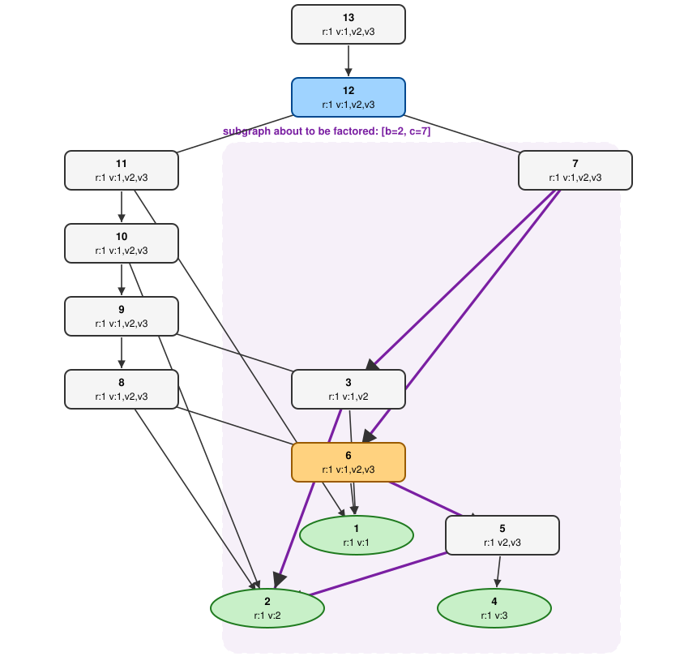
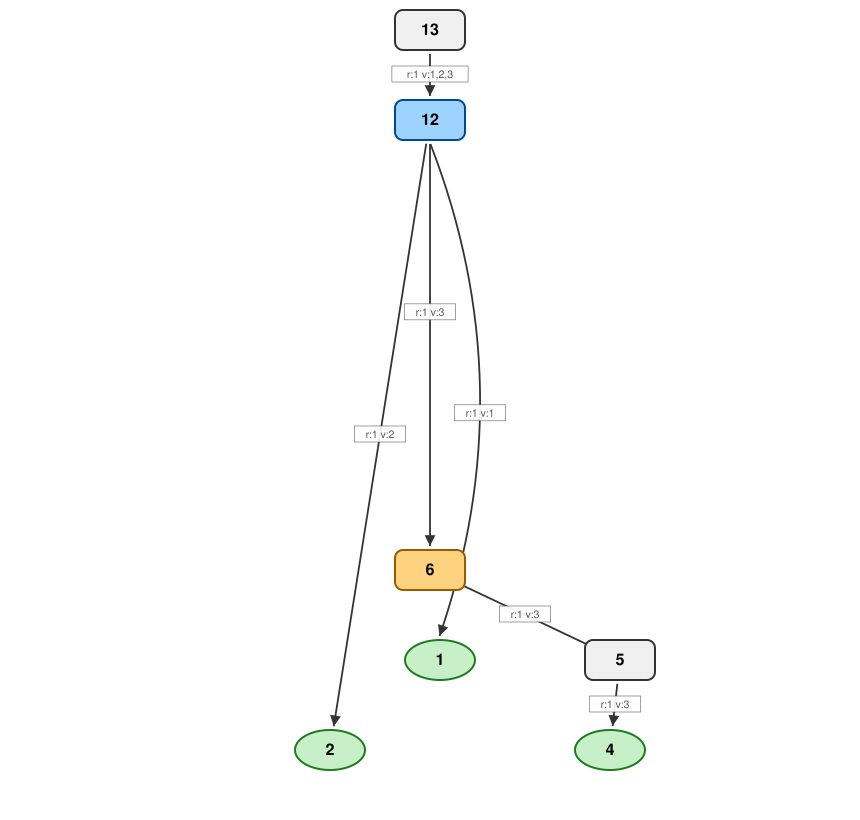

# How the Factorization Fix Works

## 1. Background

The derivative graph has one edge per local partial derivative. For root (output)
`i` and variable (input) `j`,

```
∂fᵢ/∂xⱼ = Σ over paths π from root i to variable j of  ∏_{e ∈ π} value(e)
```

Every edge carries two bit masks: `reachable_roots` (the roots above it) and
`reachable_variables` (the variables below it). A root–variable pair `(i, j)`
can use edge `e` only if bit `i` is set in `e`'s root mask and bit `j` in its
variable mask. In the diagrams below each edge is labeled with its masks, e.g.
`r:1 v:1,3`.

**Factoring** a subgraph `[b, c]` — `b` dominates `c` (every path from `c` up to
the roots in the subgraph's mask passes through `b`), or postdominates it (the
mirror image, toward the variables) — replaces the paths from `c` to `b` with
direct edges `b → c` whose values are the sums of those paths' products.
`factor!` does this for every factorable subgraph, smallest first, until each
pair `(i, j)` has a single path, which `follow_path` then reads off.

Factoring is correct only if every pair `(i, j)` gets the same path sum after
the step as before it. In a graph with several roots or variables, different
paths through `[b, c]` can serve different pairs, so the step must know, for
every pair, exactly which paths through `[b, c]` it lies on.

## 2. The bug

On `main`, `factor_subgraph!` replaces `[b, c]` with **one** edge. Its value is
the sum over all paths from `c` to `b`, and its masks are the masks recorded for
the subgraph when it was *discovered* — before any factoring took place.

Every factoring step rewrites edge masks. So by the time a subgraph is
factored, earlier steps may have changed the edges inside it, and the recorded
masks no longer describe them. Two things then go wrong:

1. **Paths with different masks are merged.** If an earlier step removed pair
   `(i, j)` from some path through `[b, c]`, that path's product is still added
   into the single replacement edge, and the edge still carries `(i, j)`. The
   pair is counted twice: once on the edge where the earlier step moved it, and
   once here.
2. **The recorded mask may name pairs the subgraph no longer serves.** The
   replacement edge then claims a pair that nothing below `c` carries any more —
   a dead end.

Either way the replacement edge's masks are wrong, and later steps read those
masks as fact. The read-out finds two edges for some pair at one node and fails
the assertion `Should only be one path from root i to variable j`, or the
duplicate is summed and the Jacobian is silently wrong. The regression tests
for issues #23, #65 and #108 in `test/test-complex-expressions.jl` fail on
`main`.

## 3. A worked example

```julia
@variables v1 v2 v3
d   = v2 - v3;  s   = v1 * d;   p   = v1 + v2
n12 = v2 + s;   n10 = p + s;    n15 = n12 * p
n16 = v2 + n15; n18 = n16 * v1; r1  = n10 + n18

jacobian([r1], [v1, v2, v3])
# main:   AssertionError: Should only be one path from root 1 to variable 2.
# branch: matches central finite differences at every test point
```

The postorder numbers are `v1 = 1`, `v2 = 2`, `p = 3`, `v3 = 4`, `d = 5`,
`s = 6`, `n10 = 7`, `n12 = 8`, `n15 = 9`, `n16 = 10`, `n18 = 11`, `r1 = 12`, and
13 is the wrapper above the root. Node 6 (`s`, orange) has two parents, and both
of their paths reconverge at node 12 (blue): `[12, 6]` is a dominator subgraph.


### Step 1 (`[2, 7]`) makes the paths through `[12, 6]` differ

`factor!` runs 14 steps on this graph. The first factors the postdominator
subgraph `[2, 7]`: node 7 reaches `v2` both through `3` and through `6 → 5`.



The two paths become one new edge `7 → 2` (value `1 + v1`), and `v2` is removed
from `7 → 3` and `7 → 6`, which no longer lead to `v2` for this pair:


This step is correct, on `main` and on this branch alike. But now the two paths
through `[12, 6]` carry different variables — `v1, v3` on the path through 7,
`v1, v2, v3` on the path through 8 — while the subgraph's recorded mask is still
`v1, v2, v3`:

![The region of [12,6] after step 1: short path through 7 (blue) carries v1,v3; long path through 8–11 (red) carries v1,v2,v3.](img/fig-region.svg)

### Step 2 (`[12, 6]`) on `main`: one edge, wrong for `v2`

`main` sums both paths into one edge and gives it the recorded mask:

```
12 → 6   v:1,2,3   value = 1 + v1·(v1 + v2)
```

The `1` is the product along the path through 7. That path no longer carries
`v2` — its `v2` contribution moved to `7 → 2` in step 1 — but the new edge
claims `v2` with the `1` included, so the pair `(r1, v2)` is counted twice.

### Step 9 (`[12, 3]`) on `main`: a dead end, then the crash

Step 6 removes the edge `3 → 2`, so node 3 now reaches only `v1`. Step 9 factors
`[12, 3]`, whose mask was recorded at discovery as `v1, v2`, and writes
`12 → 3` with `v:1,2`. Nothing below node 3 carries `v2`; the edge is a dead
end. After the remaining steps, node 12 has two children that carry `v2` —
`12 → 3` and `12 → 2` — and the read-out fails the assertion.

## 4. The new algorithm

Each step recomputes everything from the graph's **current** edge masks, and
replaces `[b, c]` with as many edges as it takes for every pair to get exactly
the sum of its own paths.

### 4.1 Path groups — `subgraph_path_groups`

Call a subgraph's roots (for a dominator subgraph) or variables (for a
postdominator subgraph) its *dominance* bits, and the other kind its
*non-dominance* bits. For a path `π` from `c` to `b`, let

```
D(π) = subgraph's dominance mask      ∩ dominance masks of every edge of π
N(π) = subgraph's non-dominance mask  ∩ non-dominance masks of every edge of π
```

`π` serves exactly the pairs in `D(π) × N(π)`. Paths with the same `(D, N)` form
a **group**; each group stores the sum of its path products and its number of
paths. Groups are computed by dynamic programming over the subgraph (memoized
from `c` toward `b`), so no path is enumerated twice. An edge is followed if it
*overlaps* both of the subgraph's masks (`on_subgraph_path`); the intersections
above then discard whatever it doesn't carry.

For `[12, 6]` after step 1:

| group | path        | D      | N          | value          | paths |
|:-----:|:------------|:-------|:-----------|:---------------|:-----:|
| G1    | 6 → 7 → 12  | `{r1}` | `{v1, v3}` | `1`            | 1     |
| G2    | 6 → 8 → … → 12 | `{r1}` | `{v1, v2, v3}` | `v1·(v1+v2)` | 1 |

### 4.2 Partitioning the pairs — `index_classes`, `factored_edges`

Each group covers a rectangle of pairs, `D × N`. Rectangles overlap — here
`(r1, v1)` lies in both — so one replacement edge per group would give a pair
two parallel edges. Instead, the pairs are partitioned into blocks such that
**every pair in a block lies in exactly the same set of groups**; each block
becomes one edge.

The partition is computed separately for the two dimensions.
`index_classes(masks, n)` takes one mask per group and splits the indices that
appear in any of them by which masks contain them:

```
classes = [ (signature = all false, indices = union of all masks) ]
for each group k with mask m:
    replace each class (sig, idx) by
        (sig with bit k set, idx ∩ m)    if nonempty
        (sig,                idx \ m)    if nonempty
```

At the end, `signature[k]` is true exactly when group `k`'s mask contains the
class's indices. This is run once on the groups' `D` masks (giving row classes)
and once on their `N` masks (giving column classes).

A pair `(i, j)` lies in group `k` iff `i ∈ D_k` and `j ∈ N_k`. So for a row class
with signature `rs` and a column class with signature `cs`, every pair in the
block lies in exactly the groups `cover = rs .& cs`. `factored_edges` emits, for
each block with a nonempty `cover`, one edge `b → c` with

- value = sum of the covered groups' values,
- dominance mask = the row class, non-dominance mask = the column class,
- path count = sum of the covered groups' path counts.

Blocks with empty `cover` contain no paths and get no edge.

For `[12, 6]`, with groups `G1, G2`:

```
rows:     {r1}                              signature (1,1)

columns:  start      {v1,v2,v3}             (0,0)
          split G1:  {v1,v3}  (1,0)   {v2}  (0,0)
          split G2:  {v1,v3}  (1,1)   {v2}  (0,1)

blocks:   {r1} × {v1,v3}   cover (1,1) → 12 → 6   v:1,3   value 1 + v1·(v1+v2)   2 paths
          {r1} × {v2}      cover (0,1) → 12 → 6   v:2     value v1·(v1+v2)       1 path
```

`(r1, v2)` now gets only the long path's product, which is correct.

`factored_edges` also returns the largest path count over all blocks. If it is
below 2, every pair already has at most one path through `[b, c]` — typically
because earlier steps already factored it — and the subgraph is left alone.

The cost of the partition depends on the numbers of groups and classes, not on
the number of roots or variables: no step loops over individual indices except
through word-level mask operations.

### 4.3 Detaching the old paths — `add_non_dom_edges!`, `reset_edge_masks!`

For each new edge, the pairs it now carries must be removed from the old paths
through `[b, c]`. Let the new edge's block have dominance bits `R` (its row
class) and non-dominance bits `C` (its column class). A **boundary edge** of
the block is an edge `e` such that

- `e` is incident to `c` on the side facing `b`: for a dominator subgraph `c`
  is `e`'s bottom vertex (`e` is a parent edge of `c`); for a postdominator
  subgraph `c` is `e`'s top vertex (`e` is a child edge of `c`);
- `e`'s dominance mask contains **all** of `R`; and
- `e`'s non-dominance mask contains **at least one** bit of `C`.

(This is `test_edge` applied to a subgraph whose masks are `R` and `C`.)
Requiring all of `R` misses nothing: the bits of `R` lie in exactly the same
path groups, so an edge on a live path through `[b, c]` carries either all of
`R` or none of it. Every old path that serves a pair in `R × C` starts at `c`
with a boundary edge, so editing the boundary edges suffices:

- `add_non_dom_edges!` splits a boundary edge whose dominance mask has bits
  outside the block's row class, so that the copy carrying the block's rows can
  be edited alone.
- `reset_edge_masks!` clears the block's column bits from that copy, and the
  edge is deleted if nothing is left.

Interior edges are not touched: paths that enter the subgraph somewhere other
than `c` still need them. In the example, `7 → 6` (`v:1,3`) is emptied by the
first block and deleted; `8 → 6` (`v:1,2,3`) loses `v1, v3` to the first block
and `v2` to the second, and is deleted. `12 → 7` stays, because `12 → 7 → 3` and
`12 → 7 → 2` still use it.

### 4.4 Removing stale bits — `prune_stale_masks!`

After detaching, interior edges still carry bits for pairs that were only
reachable through the deleted boundary edges. Since every later step reads
current masks, these must go. `prune_stale_masks!` visits the subgraph's nodes
starting next to `c`, and for each edge keeps only the non-dominance bits that
some continuing edge still carries (for the same dominance bits), splitting the
edge if different dominance bits continue differently and deleting it if
nothing remains. A bit is removed only if no continuing edge carries it, so no
live path loses an edge.

In the example `v3` was reachable only through node 6, so it is removed from
`12 → 7`, `12 → 11`, `11 → 10` and `10 → 9`; `9 → 8` keeps only `v2`, the
variable `8 → 2` still reaches.

### 4.5 Reading out — `follow_path`

`follow_path` walks the single remaining path for `(i, j)` and multiplies its
edges in decreasing order of use, so products shared by many derivatives are
built once. If it meets a branch or a dead end, it falls back to
`sum_all_paths`, a memoized sum over all paths, instead of asserting.

### 4.6 Supporting changes

- `initialize_edge_masks!` sets every edge's masks from the graph's topology
  when the `DerivativeGraph` is built (variables below, roots above).
- The `DerivativeGraph` constructor unwraps a root that is already a `NoOp`
  before wrapping it, so rebuilding a graph from existing roots does not change
  its node numbering.

## 5. Why it is correct

Let `PathSum(i, j)` be the path-product sum for pair `(i, j)` in the current
graph. Each call to `factor_subgraph!` preserves it for every pair:

- **New edges.** Groups are computed from current masks, so for each pair the
  covered groups are exactly that pair's current paths through `[b, c]`, and the
  block's edge carries exactly their sum (§4.1–4.2). Blocks are disjoint, so no
  pair gets two new edges.
- **Old paths.** Clearing a block's bits on the boundary edges at `c` removes
  that block's pairs from every old path through `[b, c]` and from no other
  path (§4.3).
- **Pruning** removes a bit only when no continuing edge carries it, so it
  deletes no live path (§4.4).

By induction over the steps, the final graph has the original path sums, in
any processing order. The masks a step reads are always the current ones,
which is what `main` got wrong.

After all 14 steps the example graph is:



Each pair has one path, node 6 (`s`) is still shared, and the edges `6 → 1`
and `5 → 2` are gone: once `12 → 1` and `12 → 2` carried the `v1` and `v2`
contributions, pruning left nothing on them.

The diagrams are generated by [`img/generate_figures.jl`](img/generate_figures.jl).
