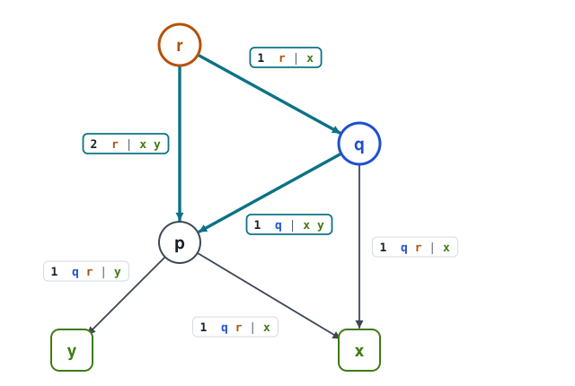

# How the Factorization Fix Works

## 1. Definitions

**Derivative graph.** A DAG whose nodes are numbered in postorder: every edge
`e` has a *top vertex* (the larger number) and a *bottom vertex* (the smaller),
and a *value*, the partial derivative of the top node with respect to the
bottom node. *Roots* are the outputs `fᵢ` (top); *variables* are the inputs `xⱼ`
(bottom). A *pair* is a root–variable pair `(i, j)`.

**Masks.** Every edge has two bit vectors: a *root mask* (`reachable_roots`),
with one bit per root, and a *variable mask* (`reachable_variables`), with one
bit per variable.

**Carries.** An edge *carries*

- root `i` if its root mask has a 1 at index `i`;
- variable `j` if its variable mask has a 1 at index `j`;
- pair `(i, j)` if it carries both root `i` and variable `j`.

A path carries a root, variable or pair if every one of its edges does.

When the graph is built, `initialize_edge_masks!` first computes, for every
node `u`,

```
roots(u)     = {i : u is root i}     ∪  ⋃ over parent edges p of u:  roots(top_vertex(p))
variables(u) = {j : u is variable j} ∪  ⋃ over child edges q of u:   variables(bott_vertex(q))
```

i.e. `roots(u)` is the set of roots with a directed path down to `u`, and
`variables(u)` the set of variables with a directed path up from them to `u`.
`variables` is computed in postorder and `roots` in reverse postorder. Then
every edge `e` gets root mask `roots(top_vertex(e))` and variable mask
`variables(bott_vertex(e))`. Factoring later edits edge masks directly; node
masks are not kept.

**Live path, path sum.** A path from root `i` down to variable `j` is *live*
for `(i, j)` if every one of its edges carries `(i, j)`. The *path sum*

```
PathSum(i, j) = Σ over live paths π for (i, j) of  ∏_{e ∈ π} value(e)
```

is `∂fᵢ/∂xⱼ`. Initially every path is live. `follow_path` and `sum_all_paths`
compute exactly this sum: they only follow edges that carry `(i, j)`.

**Factorable subgraph.** `S = [b, c]` with `b` the *dominating node* and `c` the
*dominated node*, discovered by `compute_factorable_subgraphs` before any
factoring. It is one of two kinds:

| | dominator subgraph | postdominator subgraph |
|:--|:--|:--|
| position | `b` above `c` | `b` below `c` |
| discovered for | root `i`: `b` is the immediate dominator of `c` (every path from `c` up to root `i` passes through `b`), and `c` has ≥ 2 parent edges carrying root `i` | variable `j`: mirror image (toward the variables) |
| *dominance bits* | roots | variables |
| *non-dominance bits* | variables | roots |
| *forward edges* of a node | its parent edges | its child edges |

`dom(x)` and `nondom(x)` denote the dominance and non-dominance mask of `x`,
where `x` is an edge or a subgraph. `dom(S)` is the set of roots (or variables)
for which `S` was discovered. `nondom(S)` is the set of variables below `c`
(or roots above `c`) at discovery.

**Segment.** A *segment* `π` of `S` is a directed path in the derivative graph
between `b` and `c`: from `b` down to `c` in a dominator subgraph, from `c`
down to `b` in a postdominator subgraph. *Directed* means the path goes
downward through every edge, entering at its top vertex and leaving at its
bottom vertex. A root-to-variable path that passes through both `b` and `c`
therefore consists of a path from the root to the upper of the two nodes, then a
whole segment, then a path from the lower node to the variable. Direction
decides which edge sets are segments, not the order in which products are
formed. For `[12, 6]`, the edges `12 → 11`, `11 → 1` and `6 → 1` connect 12 and
6 only by going down to 1 and back up. They are not a segment, and no
root-to-variable path contains them, so their product appears in no
derivative. Each segment has two masks:

```
D(π) = dom(S)    ∩  ⋂_{e ∈ π} dom(e)
N(π) = nondom(S) ∩  ⋂_{e ∈ π} nondom(e)
```

A pair is carried by `π` and lies within `S`'s masks exactly when its
dominance bit is in `D(π)` and its non-dominance bit is in `N(π)`; this set of
pairs is written `D(π) × N(π)`. Different segments of the same subgraph
generally have different `D` and `N`.

**Factoring** `S` (`factor_subgraph!`) replaces the segments of `S` with edges
between `b` and `c`. It is correct if every path sum is unchanged. `factor!`
factors each discovered subgraph once, in the order of a heap keyed on
`|b − c|` (smallest first) and then on `times_used = |dom(S)| · |nondom(S)|`
(largest first).

## 2. The bug

On `main`, factoring `S` adds **one** edge `b → c`. Its value is the sum over
all segments, and its masks are `S`'s masks from discovery.

Every factoring step changes edge masks. When `S` is factored, earlier steps
may already have changed the edges of its segments, so:

1. **Segments carrying different pairs are summed into one edge.** A
   segment from which an earlier step removed pair `(i, j)` still contributes
   its product to the new edge, and the new edge carries `(i, j)`. That pair's
   contribution through the segment is counted twice: on the edge where the
   earlier step moved it, and on the new edge.
2. **The new edge can carry a pair that nothing below `c` carries.** This
   creates a dead end.

Later steps read the wrong masks as fact. The read-out then either fails
`Should only be one path from root i to variable j`, or sums the duplicate and
returns a wrong Jacobian. The regression tests for issues #23, #65 and #108 in
`test/test-complex-expressions.jl` fail on `main`.

## 3. Worked example

```julia
@variables v1 v2 v3
d   = v2 - v3;  s   = v1 * d;   p   = v1 + v2
n12 = v2 + s;   n10 = p + s;    n15 = n12 * p
n16 = v2 + n15; n18 = n16 * v1; r1  = n10 + n18

jacobian([r1], [v1, v2, v3])
# main:   AssertionError: Should only be one path from root 1 to variable 2.
# branch: matches central finite differences
```

Postorder: `v1 = 1`, `v2 = 2`, `p = 3`, `v3 = 4`, `d = 5`, `s = 6`, `n10 = 7`,
`n12 = 8`, `n15 = 9`, `n16 = 10`, `n18 = 11`, `r1 = 12`. Node 13 is a no-op
wrapper above the root. Each edge is labeled with its masks: `r:1 v:1,3` means
root 1 and variables 1 and 3.


`factor!` runs 14 steps. Step 1 factors the postdominator subgraph
`S₁ = [2, 7]`: node 7 reaches `v2` by two segments, `7 → 3 → 2` and
`7 → 6 → 5 → 2`.

![The two segments of [2, 7].](img/fig-step1-highlight.svg)

Both main and this branch replace them with one edge `7 → 2` of value
`1 + v1`, and remove `v2` from `7 → 3` and `7 → 6`:



Step 2 factors the dominator subgraph `S₂ = [12, 6]`. It has two segments, and
they now carry different variables. The segment through 7 carries `v1, v3`. The
segment through 8–11 carries `v1, v2, v3`. `nondom(S₂)` still says
`v1, v2, v3`:

![The segments of [12, 6] after step 1.](img/fig-region.svg)

**On `main`**, step 2 writes one edge `12 → 6` with value `1 + v1·(v1+v2)` and
mask `v:1,2,3`. The `1` comes from the segment through 7, which no longer
carries `v2`: its `v2` contribution is on `7 → 2`. So `(r1, v2)` is counted
twice. Later, step 6 deletes `3 → 2`, and then step 9 factors `[12, 3]`. It
writes `12 → 3` with the discovery mask `v:1,2`, although node 3 no longer
reaches `v2`. At the end, node 12 has two children carrying `v2`, `12 → 3` and
`12 → 2`, and the read-out fails.

## 4. The new algorithm

`factor_subgraph!(S)` has five parts. Each one reads the current masks; none
uses `S`'s masks except to restrict which pairs it handles.

### 4.1 Region — `subgraph_region`

The **region** of `S` is the set of nodes reachable from `c` along forward
edges `e` with `dom(e) ∩ dom(S) ≠ ∅` and `nondom(e) ∩ nondom(S) ≠ ∅`
(`on_subgraph_path`), stopping at `b`. It includes `b` but not `c`. It is
computed before anything is changed, because §4.4 edits edges at `c`.

### 4.2 Groups — `subgraph_path_groups`

A **group** is the set of segments sharing one value of `(D(π), N(π))` with
both masks nonempty. For each group `k` the code stores `D_k`, `N_k`, the sum of
its segments' products `V_k`, and its number of segments `n_k`.

Groups are computed by dynamic programming, so no segment is enumerated. Each
node `u` stores the groups of the directed paths between `u` and the upper end
of the subgraph, with masks defined as for segments. For a dominator subgraph
the upper end is `b`, and the code memoizes a recursion that starts at `c`. For
a postdominator subgraph the upper end is `c`, and the code makes one pass over
the region in topological order. In both cases each product is formed from the
upper end downward.

For `S₂` after step 1:

| group | segments | `D` | `N` | `V` | `n` |
|:--:|:--|:--|:--|:--|:--:|
| G1 | 6 → 7 → 12 | `{r1}` | `{v1, v3}` | `1` | 1 |
| G2 | 6 → 8 → 9 → 10 → 11 → 12 | `{r1}` | `{v1, v2, v3}` | `v1·(v1+v2)` | 1 |

Pair `(i, j)` lies in group `k` iff `i ∈ D_k` and `j ∈ N_k`. So group `k`
covers the **rectangle** `D_k × N_k`, and the correct replacement value for a
pair is the sum of `V_k` over the groups that contain it. Rectangles may
overlap: `(r1, v1)` is in G1 and G2.

### 4.3 Partition — `index_classes`, `factored_edges`

Number the groups `1 … g`.

- An **index class** of a list of masks `m₁ … m_g` is a maximal set of bits
  contained in exactly the same masks. Its **signature** is the length-`g` bit
  vector `σ` with `σ[k] = 1` iff the class is contained in `m_k`. Bits
  contained in no mask belong to no class.
- **Row classes** are the index classes of `D₁ … D_g` (sets of dominance bits).
  **Column classes** are the index classes of `N₁ … N_g` (sets of
  non-dominance bits).
- A **block** is `R × C` for a row class `R` (signature `ρ`) and a column class
  `C` (signature `γ`). Its **cover** is `ρ .& γ`.

The blocks partition all pairs that lie in some group. A pair `(i, j) ∈ R × C`
lies in group `k` iff `i ∈ D_k` and `j ∈ N_k`, i.e. iff `ρ[k] = γ[k] = 1`. So
every pair in a block lies in exactly the groups in the block's cover, and the
block can be given one edge whose value is the sum over its cover. One edge per
group would not work: a pair in two groups would get two parallel edges.

`index_classes(masks, n)` computes the classes by successive refinement:

```
classes = [(σ = 0…0, I = m₁ ∪ … ∪ m_g)]          # one class: every index in some mask
for k in 1:g
    replace each (σ, I) in classes by
        (σ with σ[k] = 1,  I ∩ m_k)    if nonempty
        (σ,                I \ m_k)    if nonempty
```

After step `k`, two indices are in the same class iff they agree on membership in
`m₁ … m_k`. At the end, the classes are exactly the index classes. The work is
proportional to `g` times the number of classes, counted in whole-mask
operations. It never loops over individual roots or variables.

`factored_edges` then emits, for every block whose cover is nonempty, one
**replacement edge** between `b` and `c` with

- value `Σ_{k ∈ cover} V_k`,
- dominance mask `R`, non-dominance mask `C`,
- segment count `Σ_{k ∈ cover} n_k`.

A block with an empty cover contains no pair carried by a segment, so it gets
no edge. `factored_edges` also returns the largest segment count over all
blocks. If that is below 2, no pair is carried by more than one segment, and
`factor_subgraph!` changes nothing.

For `S₂`:

```
row classes      R = {r1}                               ρ = (1, 1)

column classes   start           {v1, v2, v3}           (0, 0)
                 refine by N_1   {v1, v3} (1, 0)   {v2} (0, 0)
                 refine by N_2   {v1, v3} (1, 1)   {v2} (0, 1)

blocks           {r1} × {v1, v3}  cover (1, 1)  →  12 → 6  v:1,3  value 1 + v1·(v1+v2)  2 segments
                 {r1} × {v2}      cover (0, 1)  →  12 → 6  v:2    value v1·(v1+v2)      1 segment
```

`(r1, v2)` now gets only G2's value.

### 4.4 Detaching the old segments — `add_non_dom_edges!`, `reset_edge_masks!`

Each replacement edge with block `R × C` must take its pairs off the old
segments. A **boundary edge** of the block is an edge `e` that

- is a forward edge of `c`,
- has `R ⊆ dom(e)`, and
- has `nondom(e) ∩ C ≠ ∅`.

(This is `test_edge` on a subgraph whose masks are `R` and `C`.) Every segment
`π` carrying a pair in the block starts with a boundary edge: its edge `e` at
`c` has `D(π) ⊆ dom(e)`, and `R ⊆ D(π)` because all bits of `R` lie in the
same groups.

For each replacement edge, in turn:

1. `add_non_dom_edges!` splits every boundary edge `e` with `dom(e) ⊄ R` in two.
   Both copies have the same value. One copy keeps dominance bits `R`; the other
   keeps `dom(e) \ R` and all of `e`'s non-dominance bits. Pairs outside `R` are
   unaffected.
2. `reset_edge_masks!` removes `C` from the non-dominance mask of each copy with
   dominance bits `R`. An edge left with an empty mask is deleted.
3. The replacement edge is added. A later block's edits cannot match it: blocks
   are disjoint, so either its row class differs from the later block's, which
   fails `R ⊆ dom`, or its column class is disjoint, which fails
   `nondom ∩ C ≠ ∅`.

Only edges at `c` are changed. Edges between region nodes may still be used by
paths that reach the region without passing through `c`.

Step 1 (`S₁ = [2, 7]`, postdominator: dominance bits are variables) shows the
split. There is one group, `D = {v2}`, `N = {r1}`, with 2 segments and value
`1 + v1`, giving one block `{v2} × {r1}`. Its boundary edges are the child edges
of 7 that carry `v2`: `7 → 3` (`v:1,2`) and `7 → 6` (`v:1,2,3`). Splitting
leaves copies with `v:2` and copies with `v:1` and `v:1,3`. Clearing `r1` from
the `v:2` copies empties them, and they are deleted. The result is the figure
after step 1.

In step 2 there is one root, so nothing is split. `7 → 6` (`v:1,3`) is emptied by
block `{r1} × {v1, v3}`. `8 → 6` (`v:1,2,3`) loses `v1, v3` to that block and
`v2` to `{r1} × {v2}`. Both are deleted.

### 4.5 Pruning — `prune_stale_masks!`

After §4.4, an edge between region nodes can still carry pairs whose only
continuation was a deleted boundary edge. Later steps read these masks, so they
must be exact.

For an edge `e`, let `w` be its endpoint nearer `c`. A **continuation** of `e`
is an edge leaving `w` away from `b` with a nonempty non-dominance mask. For
every edge `e` with both endpoints in the region and `w ≠ c`,
`prune_stale_masks!`:

1. partitions `dom(e)` into **parts**, maximal sets of bits contained in the
   dominance masks of exactly the same continuations;
2. for each part, keeps the bits of `nondom(e)` carried by some continuation
   whose dominance mask contains the part;
3. merges parts that keep the same bits. If more than one remains, it splits
   `e` into one edge per part. If none remains, it deletes `e`.

Nodes are visited in topological order from the `c` side, so every
continuation has already been pruned. A bit is removed only if no continuation
carries it with the same dominance bit, so no live path is broken.

In step 2, the only edges carrying `v3` out of the region were the deleted
edges into node 6. So `v3` is removed from `12 → 7`,
`12 → 11`, `11 → 10` and `10 → 9`. `9 → 8` keeps only `v2`, which `8 → 2`
carries.

### 4.6 Other changes

- **Read-out.** `follow_path` walks the unique live path for `(i, j)` and
  multiplies its edges in decreasing order of `num_uses` (root bits × variable
  bits), so shared products are built once. If it finds two candidate edges, or
  a dead end, it calls `sum_all_paths`, a memoized sum over all live paths,
  instead of asserting.
- **Mask initialization.** `initialize_edge_masks!`, described in §1.
- **Idempotent construction.** The `DerivativeGraph` constructor unwraps a root
  that is already a no-op wrapper before wrapping it. Rebuilding a graph from
  existing roots therefore keeps the same numbering.

## 5. Correctness

Fix one step, factoring `S`, and a pair `(i, j)`. The argument uses the property
`S` was discovered with: for a dominator subgraph every path from `c` up to a
root in `dom(S)` passes through `b`, and mirror-image for postdominator
subgraphs.

- **`(i, j) ∈ D(π) × N(π)` for some segment `π`.** Then the pair lies in some
  group, so it is in a block `R × C` with a nonempty cover. Every live path through `c` for the
  pair splits uniquely into an upper path, a segment carrying the pair, and a
  lower path. Summing over these paths gives (sum over upper paths) ×
  `Σ_{k ∈ cover} V_k` × (sum over lower paths). The replacement edge has value
  `Σ_{k ∈ cover} V_k` and carries the pair (§4.3), so the new paths through it
  have the same sum. Every segment carrying the pair starts with a boundary
  edge of the block, which loses the pair (§4.4), so none of the old paths
  stays live.
- **`(i, j) ∉ D(π) × N(π)` for every segment `π`.** No block with a nonempty
  cover contains it.
  So no replacement edge carries it, and §4.4 removes no bit of it: the copies it
  edits carry only `R`, and only `C` is cleared from them.
- **Paths not through `c`** are touched only by pruning, which breaks no live
  path (§4.5).

So each step preserves every `PathSum(i, j)`, and so does `factor!`. `main`
violates the first point: its replacement edge has the sum of all segments and
the discovery masks.

After all 14 steps the example graph is:


Each pair has one live path, and node 6 (`s`) is still shared. `6 → 1` and
`5 → 2` were deleted: once `12 → 1` and `12 → 2` took over their pairs, pruning
left no bits on them.

The figures are generated by [`img/generate_figures.jl`](img/generate_figures.jl).
