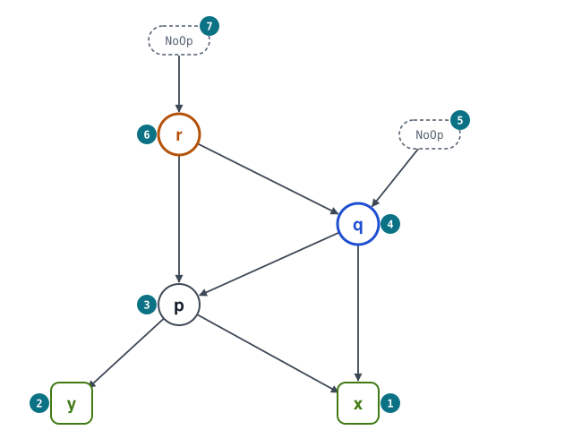
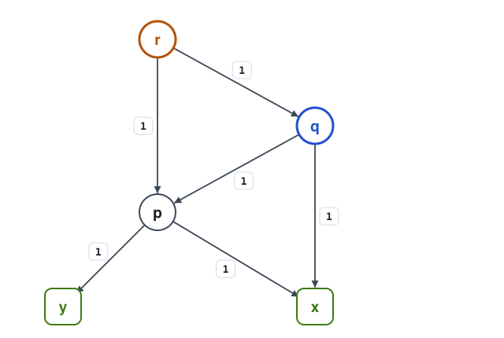
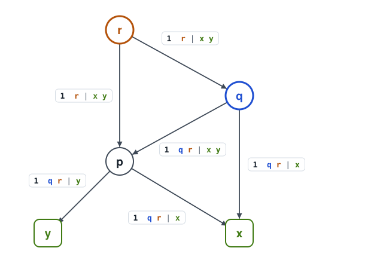
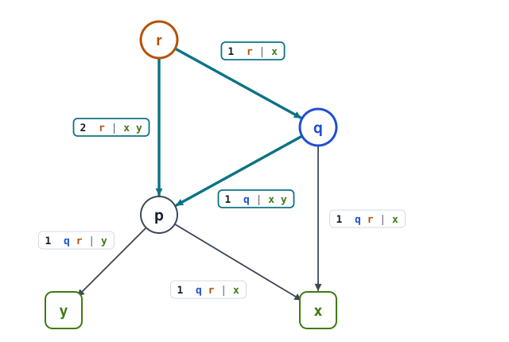
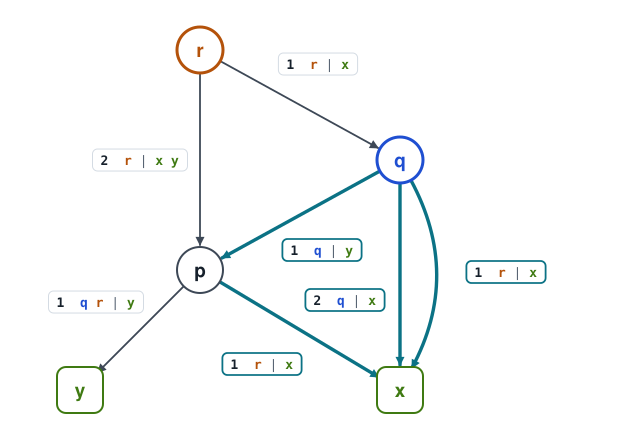
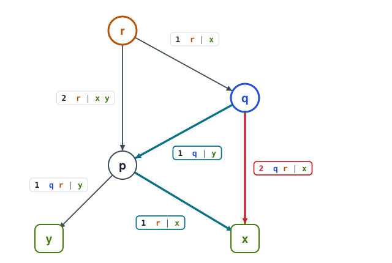
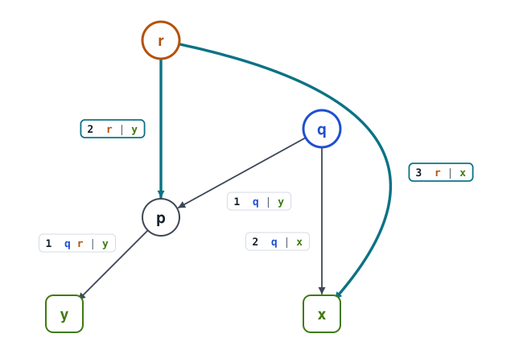
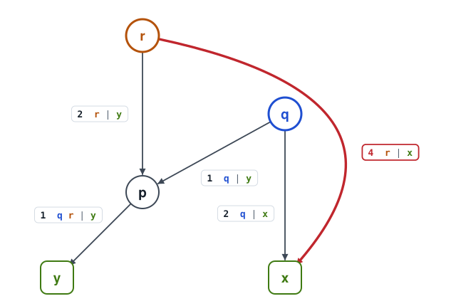
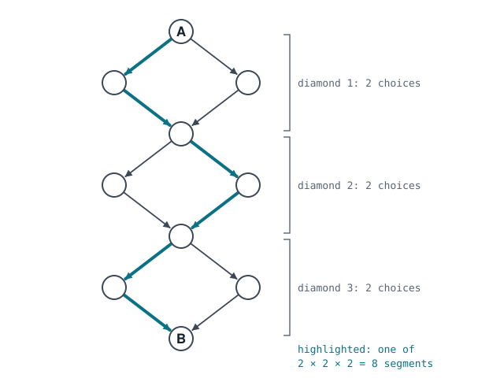

# How FastDifferentiation Works

FastDifferentiation computes derivatives symbolically. You write an expression
in ordinary Julia syntax, and it returns new expressions for the derivatives,
which it can then compile into fast Julia functions. Its derivatives are often
much cheaper to evaluate than those of other symbolic or automatic
differentiation systems, because it finds and reuses the parts of the
derivative computation that many derivatives share.

This document explains the whole algorithm, from building an expression to
running the compiled derivative, in enough detail to implement it. It leaves
out minor details, such as printing, special number types and some
conveniences, but explains everything that affects how much time or memory the
algorithm uses. Every term with a meaning specific to this algorithm is in
**bold** where it is first used and is defined in that sentence.

FastDifferentiation uses the derivative graph of the
[D\* algorithm](https://www.microsoft.com/en-us/research/publication/the-d-symbolic-differentiation-algorithm/),
but finds the parts to factor with dominator analysis (section 6), which makes
it asymptotically faster and lets it handle much larger expressions.

## Contents

1. [Overview and the running example](#1-overview-and-the-running-example)
2. [Expressions as graphs](#2-expressions-as-graphs)
3. [Numbering the nodes: postorder](#3-numbering-the-nodes-postorder)
4. [The derivative graph and the chain rule](#4-the-derivative-graph-and-the-chain-rule)
5. [Masks: which edge serves which derivative](#5-masks-which-edge-serves-which-derivative)
6. [Finding factorable subgraphs](#6-finding-factorable-subgraphs)
7. [The order of factoring](#7-the-order-of-factoring)
8. [How one subgraph is factored](#8-how-one-subgraph-is-factored)
9. [The example, step by step](#9-the-example-step-by-step)
10. [Reading off the derivatives](#10-reading-off-the-derivatives)
11. [Generating code](#11-generating-code)
12. [Other derivative operations](#12-other-derivative-operations)
13. [Why each step preserves every derivative](#13-why-each-step-preserves-every-derivative)
14. [Cost](#14-cost)
15. [Appendix A: how the group tables are computed](#15-appendix-a-how-the-group-tables-are-computed)
16. [Appendix B: why this example](#16-appendix-b-why-this-example)

## 1. Overview and the running example

A call such as `jacobian(outputs, inputs)` runs these stages:

| stage | what it does | code |
|:--|:--|:--|
| build expressions | turns Julia arithmetic into a shared graph of operations | `Node`, `simplify_check_cache` |
| number the nodes | gives every node a number below the numbers of everything that uses it | `postorder` |
| build the derivative graph | one edge per operand, holding a partial derivative | `DerivativeGraph`, `partial_edges` |
| set masks | records on every edge which outputs and inputs it serves | `initialize_edge_masks!` |
| find subgraphs | finds places where several paths merge | `compute_factorable_subgraphs` |
| factor | replaces those bundles of paths with single edges, smallest first | `factor!`, `factor_subgraph!` |
| read off | multiplies along the one remaining path per output and input | `evaluate_path`, `follow_path` |
| generate code | turns the derivative expressions into a compiled function | `make_function` |

Throughout, the document uses this example:

```julia
using FastDifferentiation
@variables x y
p = x + y
q = x + p
r = p + q
jacobian([q, r], [x, y])   # [2 1; 3 2]
```

Written out, q = 2x + y and r = 3x + 2y, so the Jacobian is `[2 1; 3 2]`. The
example is tiny, but it exercises every part of factoring, including the case
that makes the newer way of combining paths necessary. Appendix B explains how
it was chosen.

## 2. Expressions as graphs

An expression is stored as a graph of **nodes** (Julia type `Node`). A node is
one of three things:

- a **variable**, which holds a symbol such as `:x`;
- a **constant**, which holds a number;
- an **operation**, which holds a function, such as `+` or `sin`, and a list
  of **children**, the nodes it is applied to.

`@variables x y` creates two variable nodes. Every arithmetic and elementary
function in Julia has a method for `Node` arguments that builds a new
operation node instead of computing a number, so `x + y` returns an operation
node with function `+` and children `x` and `y`.

Two things happen every time an operation node is built:

1. **Simplification.** A few local rules are applied first: `0 * a = 0`,
   `1 * a = a`, `a + 0 = a`, `a - a = 0`, `a + a = 2a`, operations on two
   constants are evaluated, and constants are moved to the left of products.
   These rules only look at the node being built and its children, so each one
   takes constant time.
2. **Expression caching.** The tuple (function, child₁, child₂, …) is looked up
   in a global dictionary, the **expression cache** (`EXPRESSION_CACHE`). If an
   identical operation already exists, the existing node is returned instead
   of a new one. Children are compared by identity, so the lookup takes
   constant time.

Because of the cache, an expression that appears several times is stored once,
and the expression is a directed acyclic graph rather than a tree. This
matters twice later: the derivative graph inherits the sharing, and when the
algorithm forms derivative products, products it has formed before are reused
automatically (section 10).

## 3. Numbering the nodes: postorder

Before building the derivative graph, the code puts a **NoOp node** above each
output: an operation node whose function does nothing (`NoOp`) and whose only
child is the output. The NoOp nodes are the **roots** of the graph. They make
sure each requested output has a node of its own, even if the same expression
is requested twice, or one output is part of another (here q is part of r).
Their derivative edges have value 1, so they change no result. If an output is
already a NoOp node, it is used as it is, so rebuilding a graph from its own
roots produces the same graph.

The code then numbers the nodes with a depth-first search (`postorder`). It
visits the roots in order. At each operation node it first visits every child
that has not been visited yet, and only then gives the node the next unused
number. Constants are skipped: they get no number, and no edges lead to them,
because their derivative is zero. The resulting **postorder number** has one
property everything else relies on: every node's number is larger than the
number of each of its children, so numbers increase along every path upward.
In other words, increasing postorder is a topological order of the graph.



*Figure 1. The search starts at the NoOp above q. It visits q, then x (1), then
p, whose children are x (already numbered) and y (2), so p gets 3. Then q gets
4 and its NoOp 5. The second root's search visits r, whose children p and q
are already numbered, so r gets 6 and its NoOp 7.*

The **variables** are the variable nodes the search reaches, sorted by
postorder number; their positions in that list are the variable indices. The
roots are numbered by their position in the list of outputs. The search visits
each node and edge once, so numbering takes time proportional to the size of
the graph.

The numbers are used in four places:

- the derivative graph stores each edge with its upper node first, which is
  the endpoint with the larger number (section 4);
- masks are computed with one pass up and one pass down the numbers
  (section 5);
- dominators are computed by visiting nodes in number order, and comparing
  numbers tells which of two nodes is higher (section 6);
- the order of factoring is decided by differences of numbers (section 7).

All later figures leave out the two NoOp nodes, because they only add an edge
of value 1 above each root, and treat q and r as the roots.

## 4. The derivative graph and the chain rule

FastDifferentiation represents the derivative computation as a **derivative
graph**: the same nodes as the expression, with one line from every operation
down to each of its operands. Each line is an **edge**, and it joins an
**upper node**, the operation, to a **lower node**, the operand.

Every edge has a **value**, which is the partial derivative of its upper node
with respect to its lower node. For p = x + y, ∂p/∂x = 1 and ∂p/∂y = 1, so both
edges below p have value 1. For an edge from u = sin(v) to v, the value is
cos(v); for u = a·b, the edge to a has value b and the edge to b has value a.
Values are expressions, built from the same nodes as the original expression,
using a table of differentiation rules (`DiffRules`, plus special cases for
`+`, `*`, `abs` and `NoOp`). Building the graph (`partial_edges`) creates one
edge per (operation, non-constant child) pair, so it takes time proportional
to the size of the expression.

The roots are the nodes whose derivatives are requested, here q and r. The
variables are the inputs, here x and y. A **path** is a chain of edges that
starts at a root and goes downward, one edge at a time, until it reaches a
variable. The **path product** of a path is the product of the values of its
edges.

**The chain rule on the graph.** For any node u and variable x, the chain rule
says

```
∂u/∂x = Σ over the edges e from u down to a child c of  value(e) · ∂c/∂x
```

with ∂x/∂x = 1 and ∂z/∂x = 0 for every other variable z. Substituting the same
formula for each ∂c/∂x, and again for its children, until only variables are
left, expands ∂u/∂x into a sum over every way of going down from u to x, one
edge at a time, of the product of the edge values. That is exactly the sum of
the path products of all paths from u to x. The recursion ends because
postorder numbers decrease along every edge. So:

> The derivative of a root with respect to a variable is the sum of the path
> products of all paths between them.

Here every value is 1, so each derivative is just the number of paths:



*Figure 2. The derivative graph, roots at the top and variables at the bottom.
Each edge is labelled with its value.*

| derivative | paths | sum |
|:--|:--|--:|
| ∂q/∂x | q→x, q→p→x | 2 |
| ∂q/∂y | q→p→y | 1 |
| ∂r/∂x | r→p→x, r→q→x, r→q→p→x | 3 |
| ∂r/∂y | r→p→y, r→q→p→y | 2 |

**Why not just sum the paths?** The number of paths can grow exponentially
with the size of the graph, and different derivatives share long stretches of
the same paths. Forward-mode and reverse-mode automatic differentiation avoid
the exponential blow-up by bracketing this sum in a fixed way: forward mode
accumulates from the variables upward, one variable at a time, and reverse
mode accumulates from the roots downward, one root at a time. Each pays one
pass over the graph per variable or per root. FastDifferentiation instead
looks at the graph's structure. Wherever several paths run between the same
two nodes, it replaces them in advance with one edge whose value is their
total. This is **factoring**, and it is the subject of sections 6 to 9. After
factoring, every root–variable pair has at most one path left, and the
derivative is that path's product. Every partial sum is computed once and then
shared by every derivative that needs it.

## 5. Masks: which edge serves which derivative

Factoring rewires the graph, and afterwards the code still has to know which
edges belong to which derivative. It records this on every edge with two
**masks**, which are sets of names stored as bit vectors:

- the **root mask** (`reachable_roots`), a set of roots, with one bit per root;
- the **variable mask** (`reachable_variables`), a set of variables, with one
  bit per variable.

An edge **carries** a root if that root is in its root mask, and carries a
variable if that variable is in its variable mask. A **pair** is one root
together with one variable, such as (r, x), and an edge carries a pair if it
carries both of its names.

When the graph is built, an edge's root mask is the set of roots above it and
its variable mask is the set of variables below it. `initialize_edge_masks!`
computes these with two passes over the nodes:

```
variables(u) = {u, if u is a variable} ∪ ⋃ over child edges (u, c):  variables(c)    -- increasing postorder
roots(u)     = {u, if u is a root}     ∪ ⋃ over parent edges (w, u): roots(w)        -- decreasing postorder
for every edge (w, u):  root mask = roots(w),  variable mask = variables(u)
```

Each union is a bitwise OR of whole bit vectors, so the passes take one word
operation per 64 names per edge, that is O(E · (m + n) / 64) time for a graph
with E edges, m roots and n variables.

A path is **live** for a pair if every edge on it carries that pair. From here
on, the derivative for a pair is the sum of path products over the paths that
are live for that pair. When the masks are first set, every path is live for
the pair of its own endpoints. Factoring adds edges and removes names from
masks, and it is correct only if none of these sums changes.

In the figures, an edge label such as `1  q r | x y` means value 1, root mask
{q, r}, variable mask {x, y}.



*Figure 3. The graph with its starting masks. Edges below q carry both roots,
because both q and r lie above them. Edges leaving r carry only r.*

## 6. Finding factorable subgraphs

Factoring works on **factorable subgraphs**, which are pairs of nodes between
which two or more paths run for the same root or the same variable. There are
two kinds.

A **dominator subgraph** [A, B] has A above B. It is found for a root f when
every path from B up to f passes through A, A is the closest node to B with
that property, and B has at least two edges going up toward f.

A **postdominator subgraph** [A, B] is the mirror image, with A below B. It is
found for a variable v when every path from B down to v passes through A, A is
the closest node to B with that property, and B has at least two edges going
down toward v.

In both kinds, A is the **dominating node** and B is the **dominated node**. A
subgraph's **dominance mask** is the set of names it was found for: roots for
a dominator subgraph, variables for a postdominator subgraph. Its
**non-dominance mask** holds names of the other kind, as they stood when the
subgraph was found: the variables below B for a dominator subgraph, or the
roots above B for a postdominator subgraph. For an edge, the same words pick
out one of its two masks. In a dominator subgraph an edge's dominance mask is
its root mask and its non-dominance mask is its variable mask; in a
postdominator subgraph it is the other way round.

A **segment** of a subgraph is a chain of edges that runs downward from one of
its two nodes to the other: from A down to B in a dominator subgraph, or from B
down to A in a postdominator subgraph. To **factor** a subgraph is to replace
its segments with direct edges between A and B, whose values are sums of
segment products, and to edit masks so that the old segments stop being live
for the pairs the new edges take over.

### Computing dominators

For a root f, the **immediate dominator** of a node B, idom_f(B), is the
closest node above B through which every path from B up to f passes.
`compute_dom_table` computes it for every node below f:

```
idom(f) = f
visit the nodes below f in decreasing postorder number:        -- a max-heap of node numbers
    P = the parents of B whose edge to B carries root f
    idom(B) = P[1] if P has one element,
              otherwise fold intersect over P
intersect(a, b):                                                -- walk up until the two meet
    while a ≠ b:
        if number(a) < number(b): a = idom(a) else b = idom(b)
    return a
```

Decreasing postorder visits every parent before its children, so the idoms
`intersect` needs are always ready. Comparing numbers decides which of the two
walkers is lower and must move up; this is the same intersection step as in
the Cooper–Harvey–Kennedy dominator algorithm, using postorder numbers in
place of a reverse-postorder index. Postdominators for a variable v are
computed the same way with the directions swapped: start at v, visit the
nodes above it in increasing postorder (a min-heap), use the children whose
edge carries v, and in `intersect` move the higher-numbered walker down.

Each table visits every node reachable from its root or variable once, so it
takes O(V log V + E · h) time, where h is the length of the walks in
`intersect`. The log V comes from the binary heap used to visit the nodes in
order. The walks are not bounded by a constant: h can grow with the depth of
the dominator tree, and on graphs built for the purpose a single table takes
time quadratic in the size of the graph. Section 14 shows how the cost grows
on the examples used in the tests.

### Discovering the subgraphs

`compute_factorable_subgraphs` computes one dominator table per root and one
postdominator table per variable, before any factoring. For root f, every node
B with idom_f(B) = A and at least two parent edges carrying f gives the
dominator subgraph [A, B]. For variable v, every node B with
pidom_v(B) = A and at least two child edges carrying v gives the
postdominator subgraph [A, B]. Dominator subgraphs whose B is a constant are
skipped.

The same node pair is usually found for several roots (or variables). The code
keeps one subgraph per (kind, A, B) and sets one bit in its dominance mask for
each root (or variable) it was found for. The non-dominance mask is the set of
variables below B (or roots above B). The subgraph also records its **times
used**, the number of root–variable pairs whose paths can pass through it:
the size of its dominance mask times the size of its non-dominance mask.

The tables are computed once, at the start, and the list of subgraphs is never
recomputed. Factoring one subgraph can leave another with fewer segments than
when it was found, or with only one segment per pair, in which case factoring
it does nothing (section 8, Part 3).

In the example there are six subgraphs:

| subgraph [A, B] | kind | found for | dominance mask | non-dominance mask | times used |
|:--|:--|:--|:--|:--|--:|
| [r, p] | dominator | root r | {r} | {x, y} | 2 |
| [x, q] | postdominator | variable x | {x} | {q, r} | 2 |
| [p, r] | postdominator | variable y | {y} | {r} | 1 |
| [q, x] | dominator | root q | {q} | {x} | 1 |
| [r, x] | dominator | root r | {r} | {x} | 1 |
| [x, r] | postdominator | variable x | {x} | {r} | 1 |

For example, [x, q] is a postdominator subgraph because every path from q down
to x ends at x, and q has two edges going down toward x: q→x and q→p.

## 7. The order of factoring

The subgraphs go into a binary heap (`factor_order`) and are factored one at a
time. The ordering has two keys:

1. **Node difference, smallest first.** The **node difference** of a
   subgraph is |number(A) − number(B)|, the difference between the postorder
   numbers of its two nodes.
2. **Times used, largest first.** Times used is compared only between
   subgraphs with the same node difference. Remaining ties are broken
   arbitrarily.

**Why node difference first.** Take two subgraphs, S with node difference 10
and T with node difference 20. S may be, but is not necessarily, contained in
T.

- **If S is contained in T,** its node difference is necessarily smaller, so
  S is factored first (the argument is below). This guarantees that by the
  time T is factored, its internal subgraphs have already been converted into direct edges
  between their two nodes (one edge per block of section 8, usually just
  one). T then sees those edges instead of all the paths inside them, and
  each inner sum is built once and reused inside every larger sum that
  contains it. This is what keeps factoring efficient.
- **If S is not contained in T,** factoring S before T does no harm:
  factoring gives correct derivatives in any order (section 13).

Checking containment exactly would cost more than it saves, so the code uses
node difference for every pair of subgraphs, whether or not one contains the
other.

**Why node difference works as a containment test.** Call the higher-numbered
of a subgraph's two nodes its top and the other its bottom (for a dominator
subgraph the top is A, for a postdominator subgraph it is B). Say S is
**contained** in T if both of S's nodes are nodes of T (T's top, its bottom,
or in its region) and S and T do not have the same two nodes.

1. **Numbers fall along every edge going down.** The postorder search gives a
   node its number only after it has numbered everything below it, so a node's
   number is larger than the number of every node below it, not only of its
   children.
2. **Every node of T lies between T's top and bottom.** Take a dominator
   subgraph T = [A, B] found for root f. Its region is built by walking up
   from B along edges that carry f (or another root of its dominance mask),
   stopping at A. A node u reached this way is above B. It is also below A:
   there is a path from u up to f, every path from B up to f passes through
   A, and the walk reached u without passing A, so A must lie on the part of
   the path above u. The postdominator case is the mirror image. By step 1,
   number(bottom of T) ≤ number(u) ≤ number(top of T) for every node u of T.
3. **So S's numbers lie inside T's range.** S's top and bottom are nodes of
   T, so number(top of S) ≤ number(top of T) and
   number(bottom of S) ≥ number(bottom of T). Subtracting,
   node_difference(S) ≤ node_difference(T).
4. **The inequality is strict.** Equality needs top(S) = top(T) and
   bottom(S) = bottom(T), that is, the same two nodes, which the definition of
   containment excludes. Such pairs exist, a dominator and a postdominator
   subgraph on the same two nodes, like [r, x] and [x, r] in the example, but
   neither is inside the other, and they are ordered by times used.

The converse fails: a smaller node difference does not imply containment,
because unrelated parts of the graph can have any numbers. That is why node
difference is only a possible-containment test, and why it is enough that
factoring an uncontained S first does no harm.

The argument was checked by computing the regions with the code's own
`subgraph_region` on the example and 300 random graphs: in all 148,983 pairs
where one subgraph was contained in another, the inner one had the strictly
smaller node difference.

**Why times used second.** Two subgraphs with the same node difference cannot
be strictly contained in one another, so for them the order only matters for
sharing. Factoring first the subgraph that more root–variable pairs pass
through tends to produce products that more derivatives share. This is a
cheap heuristic which produces efficient derivative code in practice.

In the example, the subgraphs [r, p], [x, q], [p, r] and [q, x] all have node
difference 3, and [r, x] and [x, r] have 5. The first two have times used 2,
so the order is:

| step | subgraph | node difference | times used |
|:--:|:--|--:|--:|
| 1 | [r, p] | 6 − 3 = 3 | 2 |
| 2 | [x, q] | 4 − 1 = 3 | 2 |
| 3 | [p, r] | 6 − 3 = 3 | 1 |
| 4 | [q, x] | 4 − 1 = 3 | 1 |
| 5 | [r, x] | 6 − 1 = 5 | 1 |
| 6 | [x, r] | 6 − 1 = 5 | 1 |

## 8. How one subgraph is factored

`factor_subgraph!` has five parts. Every part reads the masks as they are at
that moment, after all earlier steps. The subgraph's own masks, which were
recorded before any factoring, only limit which pairs the step handles.

### Part 1. The region (`subgraph_region`)

A **forward edge** of a node is an edge that leaves it in the direction of A:
an upward edge in a dominator subgraph, a downward edge in a postdominator
subgraph. The **region** of the subgraph is the set of nodes the code reaches
by starting at B and following forward edges, using only edges that carry at
least one name from each of the subgraph's two masks, and stopping at A. It is
the inside of the subgraph plus A. The code records the region first, because
Part 4 changes edges at B.

### Part 2. Groups of segments (`subgraph_path_groups`)

Each segment gets two masks of its own. Its **segment dominance mask** is the
subgraph's dominance mask intersected with the dominance masks of all the
segment's edges. Its **segment non-dominance mask** is formed the same way
from non-dominance masks. A segment carries exactly the pairs made of one name
from each of these two masks, because those are the pairs every one of its
edges carries.

A **group** is a set of segments whose two segment masks are identical and both
non-empty. For each group the code keeps the two masks, the sum *V* of its
segments' path products, and the number *n* of its segments. Segments with an
empty segment mask carry no pair the subgraph handles, and belong to no group.

The number of segments can grow exponentially, so the code never lists them.
Instead it gives each region node u a **table** G(u), which maps a pair of
masks (Dm, Nm) to the sum V of the products and the number n of the chains of
edges between u and the upper of the two nodes that have exactly those masks
(computed as for segments). For a dominator subgraph the upper node is A:

```
G(A) = { (dominance mask of S, non-dominance mask of S) ↦ (V = 1, n = 1) }

G(u) = for each forward edge e of u, with w its upper node,
         for each entry (Dm, Nm) ↦ (V, n) of G(w):
           key = (dominance mask of e ∩ Dm, non-dominance mask of e ∩ Nm)   -- skipped if either is empty
           add V · value(e) and n to G(u)[key]
```

The groups are the entries of G(B). Each table is computed once (memoized), so
the work is proportional to the number of region edges times the number of
distinct mask pairs, not to the number of segments. For a postdominator
subgraph the upper node is B, and the same tables are pushed downward from B
to A, one region node at a time in topological order. In both cases every
product is formed from the upper node downward, the same order `follow_path`
uses, so that products can be shared. [Appendix A](#15-appendix-a-how-the-group-tables-are-computed)
explains this dynamic program in detail.

### Part 3. Blocks and replacement edges (`index_classes`, `factored_edges`)

A pair belongs to every group whose two masks contain its two names, so its
correct new value is the sum of *V* over those groups. Different pairs can
belong to different sets of groups, so the code sorts the pairs into blocks.

A **row class** is a largest set of dominance names that lie in exactly the
same groups' segment dominance masks. A **column class** is the same thing for
non-dominance names and segment non-dominance masks. A **block** is one row
class combined with one column class: all the pairs made of one name from
each. The block's **cover** is the set of groups that contain the block. Every
pair in a block lies in exactly the groups of its cover. One edge per group
would not work, because a pair that lies in two groups would then get two
parallel edges and be counted twice.

`index_classes` finds the classes by refining one mask at a time. Its cost
depends on the number of groups and classes, never on the total number of
roots or variables:

```
classes = [(signature 0…0, every name in some mask)]
for k in 1:number of groups
    replace each (σ, I) in classes by
        (σ with σ[k] = 1,  I ∩ mask k)   if non-empty
        (σ,                I \ mask k)   if non-empty
```

The **signature** σ of a class records which groups' masks contain it, so the
cover of a block is the bitwise AND of its row and column signatures.

Each block with a non-empty cover becomes one **replacement edge** between A
and B. Its value is the sum of *V* over the cover, its dominance mask is the
row class, and its non-dominance mask is the column class. If every block's
cover holds fewer than two segments in total, no pair has more than one
segment, and the step changes nothing.

### Part 4. Detaching the old segments (`add_non_dom_edges!`, `reset_edge_masks!`)

Before it adds a replacement edge, the code takes that edge's pairs off the
old segments. A **boundary edge** of a block is a forward edge of B whose
dominance mask contains the whole row class and whose non-dominance mask
shares at least one name with the column class. Every segment that carries a
pair of the block starts with a boundary edge. For each block, in turn, the
code:

1. splits every boundary edge that also carries dominance names outside the
   row class. To **split** an edge is to replace it with two copies that have
   the same value: one copy keeps only the row class's dominance names, and
   the other keeps the remaining dominance names and all of the original
   non-dominance names;
2. removes the column class from the non-dominance mask of each boundary edge
   that now holds just the row class;
3. deletes every edge whose mask became empty;
4. adds the replacement edge.

Blocks are disjoint, so a later block's boundary test never matches an earlier
block's replacement edge. Only edges at B are changed here. Edges further
inside may still be used by paths that never pass through B.

### Part 5. Pruning (`prune_stale_masks!`)

After Part 4, an edge inside the region can still carry names whose only way
onward was a boundary edge that lost them. **Pruning** removes such names. For
an edge inside the region, its **continuations** are the edges that leave its
B-side end moving away from A and still carry something. The code keeps a
non-dominance name on the edge, for a given dominance name, only if some
continuation carries both. If different dominance names keep different sets,
the edge is split. It works outward from B, so each continuation has already
been pruned before it is consulted. Later steps rely on these masks being
exact.

## 9. The example, step by step

In the figures below, teal and purple mark the first and second segment of
the subgraph being factored, a dashed ring marks the dominating node and a
solid ring the dominated node, teal labels mark edges added or changed by the
step, red marks an edge that is wrong, and grey edges take no part in the
step.

### Step 1: dominator subgraph [r, p]

![Figure 4. The two segments of [r, p]: r→p, and r→q→p.](img/fig-step1.svg)

*Figure 4. Every path from p up to root r ends at r, and p has two edges going
up that carry r. The two segments are r→p and r→q→p.*

- **Region:** starting at p and following upward edges gives {q, r}.
- **Groups:** both segments carry {r} × {x, y}, so there is one group with
  *V* = 1 + 1·1 = 2 and *n* = 2.
- **Blocks:** one row class {r} and one column class {x, y}, so one
  replacement edge r→p with value 2 and masks `r | x y`.
- **Detaching:** the boundary edges are the upward edges of p, r→p and q→p.
  q→p also carries q, so it is split into a q copy and an r copy. The r copy
  and the old r→p lose {x, y}, become empty, and are deleted. What remains is
  q→p with `q | x y`.
- **Pruning:** r→q carried y only so that r could reach y through q→p. Its
  continuations are q→x (`q r | x`) and q→p (`q | x y`). Only q→x carries r,
  and it carries only x, so r→q becomes `r | x`.



*Figure 5. After step 1. q→p no longer carries r, and r→q no longer carries y.*

Check: ∂r/∂x now has live paths r→p→x (2·1) and r→q→x (1·1), which give 3 as
before. The important change for what follows is that the path q→p→x is no
longer live for r, because r's share of it now travels on the value-2 edge
r→p.

### Step 2: postdominator subgraph [x, q]

![Figure 6. The two segments of [x, q]: q→x carries roots q and r; q→p→x carries only root q.](img/fig-step2.svg)

*Figure 6. The subgraph's masks, recorded before step 1, say that both
segments serve roots {q, r}. After step 1, only q→x still carries r.*

- **Region:** starting at q and following downward edges that carry x gives
  {p, x}.
- **Groups:** the segments now have different segment masks, so there are two
  groups:

| group | segment | segment dominance mask | segment non-dominance mask | *V* | *n* |
|:--|:--|:--|:--|--:|--:|
| G1 | q→x | {x} ∩ {x} = {x} | {q,r} ∩ {q,r} = {q, r} | 1 | 1 |
| G2 | q→p→x | {x} ∩ {x,y} ∩ {x} = {x} | {q,r} ∩ {q} ∩ {q,r} = {q} | 1 | 1 |

- **Blocks:** the only dominance name is x, and it lies in both groups, so
  there is one row class {x}. The non-dominance names split by group
  membership: q lies in G1 and G2, and r lies only in G1. That gives two
  column classes and two blocks:

| | {q}: in G1, G2 | {r}: in G1 |
|:--|:--|:--|
| **{x}**: in G1, G2 | cover {G1, G2}, value 1 + 1 = **2** | cover {G1}, value **1** |

So factoring makes one edge per block:



*Figure 7. Value 2 for q and value 1 for r. For r, the live paths to x are
r→q→x = 1·1 and r→p→x = 2·1, which sum to 3.*

- **Detaching, block {x} × {q}:** the boundary edges are q→x (`q r | x`) and
  q→p (`q | x y`). q→p also carries y, outside the row class, so it is split
  into an x copy and a y copy. Removing q empties the x copy, so it is
  deleted, and leaves q→x with `r | x`. Then the value-2 edge is added.
- **Detaching, block {x} × {r}:** the only boundary edge is now q→x
  (`r | x`). Removing r empties it, so it is deleted, and the value-1 edge is
  added.
- **Pruning:** p→x carried q for the path q→p→x, but q→p no longer carries x.
  Its only continuation that carries x is r→p, which carries only r, so p→x
  becomes `r | x`.

**A simpler rule that does not work.** FastDifferentiation 0.4.5 and earlier
factored every subgraph into a single edge whose value was the sum over all
segments and whose masks were the subgraph's original masks. That is correct
only if every segment still carries every pair in those masks. Here step 1
took r off the segment q→p→x, so the single edge hands r a contribution that r
already receives through r→p:



*Figure 8. The single-edge rule gives q→x value 1 + 1 = 2 for both roots. For
r, the live paths to x are then r→q→x = 1·2 and r→p→x = 2·1, which sum to 4
instead of 3: the contribution of q→p→x is counted twice, once inside r→p and
again inside this edge.*

Grouping segments by the masks they actually carry, and giving each block its
own edge, is what fixes this.

### Steps 3 and 4: nothing left to merge

Step 3, [p, r] for variable y: after step 1 only r→p carries y out of r, so
there is a single segment. Step 4, [q, x] for root q: after step 2 only the
value-2 edge q→x carries q into x. In both steps every block covers just one
segment, so Part 3 reports nothing to do.

### Step 5: dominator subgraph [r, x]

![Figure 9. The segments of [r, x]: r→q→x through the value-1 edge, and r→p→x.](img/fig-step5.svg)

*Figure 9. The segments for r are r→q→x through the value-1 edge, and r→p→x.
The value-2 edge carries only q, so its segment mask for r is empty and it is
in no group.*

There is one group, *V* = 1·1 + 2·1 = 3, *n* = 2, so one replacement edge r→x
with value 3. Detaching deletes the boundary edges q→x (value 1) and p→x.
Pruning then deletes r→q, which no longer leads anywhere for r, and trims r→p
to `r | y`.



*Figure 10. The final graph.*

Step 6, [x, r], finds that r has only one edge going down toward x, and does
nothing. The single-edge rule of Figure 8 would end with the same shape but
with r→x = 4:



*Figure 11. The final graph under the single-edge rule.*

## 10. Reading off the derivatives

After factoring, each pair has at most one live path, and the derivative is
that path's product. For each requested variable and each root,
`evaluate_path` handles the trivial cases (a root that is a variable or a
constant), and otherwise `follow_path`:

1. starts at the root and repeatedly takes the one child edge that carries the
   pair, until it reaches the variable;
2. returns 0 if the root has no such edge;
3. sorts the edges of the path in decreasing order of their **number of
   uses**, the size of their root mask times the size of their variable mask,
   and multiplies them in that order.

The sort matters for efficiency. An edge with many uses lies on the paths of
many pairs. Multiplying the most used edges first gives different pairs the
same leading partial products, such as (e₁·e₂), and the expression cache
(section 2) turns identical products into the same node. So each shared
product is built, and later evaluated, once.

If `follow_path` ever finds two edges that carry the pair, or a dead end below
the root, it falls back to `sum_all_paths`, which adds up the products of all
live paths with a memoized recursion over the nodes. Factoring leaves one path
per pair, so this fallback is a safety net; it is also correct, because live
path sums are what factoring preserves.

| pair | live path | derivative |
|:--|:--|--:|
| (q, x) | q→x | 2 |
| (q, y) | q→p→y = 1·1 | 1 |
| (r, x) | r→x | 3 |
| (r, y) | r→p→y = 2·1 | 2 |

`jacobian` returns these as a matrix of expressions, with one column for each
requested variable, in the requested order. The graph is factored over all of
its variables, but only the requested columns are read. A variable that does
not occur in the graph gets a column of zeros. `sparse_jacobian` reads the
same entries but stores only the ones that are not identically zero.

## 11. Generating code

The derivative expressions share most of their nodes, with each other and
with the original expression. `make_function(J, inputs)` turns an array of
expressions into one straight-line Julia function that computes each shared
node once:

1. One dictionary maps each node already emitted to the local variable that
   holds its value. It is shared by all entries of the array.
2. For each entry, a depth-first search emits, in postorder, one assignment
   `tmpₖ = f(args…)` for every operation node not already in the dictionary.
   Variables become array reads from the input vectors, and constants are
   inlined.
3. `result[i] = tmp` stores the entry.

The generated function's body has one statement per distinct node, so its
size, and the time to evaluate it, are proportional to the number of distinct
nodes in all entries together. Before emitting statements, the code counts
zero and constant entries; if most entries are zero (or constant) it fills
the result array in one statement and skips those entries afterwards. An
`in_place = true` option writes into a result array the caller provides. The
expression is compiled with `RuntimeGeneratedFunctions`, which avoids the
world-age problems of `eval`.

## 12. Other derivative operations

All other operations reduce to building, factoring and reading a derivative
graph:

- **Hessian** (`hessian`): compute the gradient with `jacobian`, then build a
  new derivative graph from the gradient's expressions and compute its
  Jacobian. `sparse_hessian` does the same with `sparse_jacobian`.
- **Jacobian times a vector** (`jacobian_times_v`): create fresh variables
  v₁ … vₙ. After factoring, multiply the value of every edge into variable xⱼ
  by vⱼ. Each root's single path to xⱼ then has product (∂fᵢ/∂xⱼ)·vⱼ, and
  summing over j gives (Jv)ᵢ without forming J.
- **Transposed Jacobian times a vector** (`jacobian_transpose_v`): the same,
  multiplying every edge out of root fᵢ by a fresh variable rᵢ and summing over
  roots.
- **Hessian times a vector** (`hessian_times_v`): `jacobian_times_v` applied to
  the gradient.
- **Higher derivatives** (`derivative(A, x, y, …)`): repeated Jacobians,
  keeping one column each time.

## 13. Why each step preserves every derivative

Fix one step, factoring subgraph S = [A, B], and one pair. The argument uses
the property S was found with: for a dominator subgraph, every path from B up
to a root in S's dominance mask passes through A, and the mirror image for a
postdominator subgraph.

- **Some segment carries the pair** (within S's masks). Then the pair lies in
  some group, so it is in a block with a non-empty cover. Every live path
  through B for the pair splits uniquely into a part above the subgraph, a
  segment carrying the pair, and a part below it. Summing over these paths
  gives (sum over upper parts) × (sum of *V* over the cover) × (sum over lower
  parts). The replacement edge has value equal to the sum of *V* over the
  cover and carries the pair, so the new paths through it have the same sum.
  Every segment carrying the pair starts with a boundary edge of the block,
  which loses the pair in Part 4, so none of the old paths stays live.
- **No segment carries the pair.** No block with a non-empty cover contains
  it, so no replacement edge carries it, and Part 4 removes no name of it:
  the copies it edits keep only the row class, and only the column class is
  removed from them.
- **Paths that do not pass through B** are touched only by pruning, which
  removes a name only if no continuation carries it with the same dominance
  name, so no live path is broken.

So each step preserves every derivative, and so does the whole of `factor!`,
in any order. The single-edge rule of section 9 breaks the first point: its
edge carries a pair with a value that includes segments which no longer carry
that pair.

## 14. Cost

Write V for the number of nodes, E for the number of edges, m for the number
of roots and n for the number of variables. A **mask operation** is an AND,
OR, comparison or hash of one mask, which takes time proportional to m or n
divided by the machine word size (64).

| stage | cost |
|:--|:--|
| building expressions | O(1) per operation, with the expression cache |
| postorder numbering, derivative edges | O(V + E) |
| initial masks | O(E) mask operations |
| dominator tables | one traversal per root and per variable: O((m + n) · (V log V + E · h)), where h is the length of the walks in `intersect`; a single table can be quadratic in the worst case |
| subgraph discovery and ordering | O(S log S) for S subgraphs, plus the tables above |
| factoring | per subgraph: proportional to the edges of its region times the sizes of its group tables (below) |
| reading off | O(L log L) per pair for a path of L edges: O(m · n · L log L) in all |
| generating code | O(number of distinct nodes in the result) |

The dominator tables usually dominate the cost of finding subgraphs, because
the graph is traversed once for every root and every variable. (The
constructor also runs an older reachability routine, `compute_edge_paths!`,
whose results `initialize_edge_masks!` overwrites; an implementation can omit
it.)

**Dominator tables on the test examples.** A single table can take quadratic
time (section 6), because the `intersect` walks can be long. On the scalable
examples used in the tests the walks stay short, as measured by
[`scripts/measure_dominators.jl`](scripts/measure_dominators.jl) over all the
tables `compute_factorable_subgraphs` builds for each example:

| example | nodes | edges | tables (roots + variables) | intersect steps | steps per edge per table | time (ms) |
|:--|--:|--:|--:|--:|--:|--:|
| spherical harmonics, order 5 | 82 | 102 | 28 | 129 | 0.05 | 0.1 |
| spherical harmonics, order 10 | 391 | 541 | 103 | 3434 | 0.06 | 0.6 |
| spherical harmonics, order 15 | 920 | 1300 | 228 | 15589 | 0.05 | 2.7 |
| spherical harmonics, order 20 | 1671 | 2381 | 403 | 42344 | 0.04 | 6.7 |
| Chebyshev polynomial, degree 20 | 41 | 77 | 2 | 167 | 1.08 | 0.0 |
| Chebyshev polynomial, degree 40 | 81 | 157 | 2 | 347 | 1.11 | 0.0 |
| Chebyshev polynomial, degree 80 | 161 | 317 | 2 | 707 | 1.12 | 0.1 |
| Chebyshev polynomial, degree 160 | 321 | 637 | 2 | 1427 | 1.12 | 0.1 |
| heat equation, 5 points | 36 | 45 | 11 | 0 | 0.0 | 0.0 |
| heat equation, 20 points | 141 | 180 | 41 | 0 | 0.0 | 0.1 |
| heat equation, 80 points | 561 | 720 | 161 | 0 | 0.0 | 0.3 |
| heat equation, 320 points | 2241 | 2880 | 641 | 0 | 0.0 | 2.6 |

"Steps per edge per table" is the number of intersect steps divided by edges
times tables. It stays roughly constant as each example grows, so on these
examples the walks contribute work proportional to the size of the graph per
table, not quadratic work. The total still grows with the number of tables:
spherical harmonics of order 20 has 403 roots and variables, and each needs
its own traversal. Reducing the asymptotic cost of this stage, both the
quadratic worst case of the walks and the one traversal per root and
variable, is left for a future change.

Factoring the subgraphs in order of node difference (section 7) is what keeps
the factoring stage, and the size of the result, from growing with the number
of paths: inner bundles become single edges before any bundle that contains
them is processed, so every partial sum is formed once.

The cost of one factoring step depends on the group tables. Let *n* be the size
of S's dominance mask and *m* the size of its non-dominance mask.

- **Groups.** Each key of a table G(u) is a pair of non-empty subsets of the
  *n* dominance and *m* non-dominance names, and each chain of edges from u to
  the upper node contributes one key. So |G(u)| ≤ min(P(u), (2ⁿ − 1)(2ᵐ − 1)),
  where P(u) is the number of those chains, and computing all tables takes at
  most the sum of |G(w)| over the region edges (u, w) in mask operations. For
  arbitrary masks the exponential bound is reached, for example by *n* + *m*
  diamond shaped graphs in a row (Figure 12), each dropping one name on one
  of its two sides.
- **Masks as built by `initialize_edge_masks!`** make every table have one
  entry. Every region node lies on a path between A and B, so every edge's
  masks contain S's masks. Different mask pairs arise only from edges that
  earlier factoring steps edited. No polynomial bound in *n* and *m* is known
  for those.
- **Blocks.** Row classes are disjoint non-empty sets of the *n* dominance
  names, so there are at most *n* of them, and at most *m* column classes.
  With *g* groups, `index_classes` takes O(*g*·(*n* + *m*)) mask operations,
  and there are at most *n*·*m* blocks, hence at most *n*·*m* replacement
  edges.

Measured just before each step of `factor!` by
[`scripts/measure_groups.jl`](scripts/measure_groups.jl):

| problem | steps | max groups at B | max \|G(u)\| | (*n*, *m*) where max occurs |
|:--|--:|--:|--:|:--|
| running example | 6 | 2 | 2 | (1, 2) |
| gradient of Rosenbrock, 60 variables | 235 | 1 | 1 | (1, 1) |
| gradient of Σ sin(xᵢxᵢ₊₁)·exp(xᵢ), 40 variables | 467 | 1 | 1 | (1, 1) |
| dense map xᵢ·sin(Σⱼ xⱼ(i+j)/20), 20 in, 20 out | 40 | 1 | 1 | (1, 1) |
| random graph 1 (8 in, 8 out, 70 shared ops) | 128 | 4 | 4 | (1, 3) |
| random graph 2 | 94 | 6 | 6 | (1, 6) |
| random graph 3 | 155 | 6 | 6 | (3, 3) |
| random graph 4 | 198 | 4 | 4 | (1, 8) |

Random graph 1 has 4 groups with *n* = 1, *m* = 3, so the number of groups is
not bounded by *n*·*m*.

## 15. Appendix A: how the group tables are computed

Part 2 of section 8 needs, for every distinct pair of segment masks, the sum
*V* of the path products and the number *n* of the segments that have those
masks. This appendix explains how `subgraph_path_groups` gets them without
listing segments, using dynamic programming, and works through the two
subgraphs of the example that need it.

### Why the segments cannot simply be listed

The number of segments can grow exponentially with the size of the subgraph.
Put *k* diamond shaped graphs in a row. Each diamond shaped graph is a node
with edges down to two different nodes, and both of those have an edge down to
the same next node, where the next diamond shaped graph starts. A segment
through them picks one of two sides in every diamond shaped graph, so there
are 2ᵏ segments, although the region has only 4*k* edges.



*Figure 12. Three diamond shaped graphs in a row. Each one offers two ways
down, so there are 2 × 2 × 2 = 8 segments from A to B; one is highlighted.
With k of them there are 2ᵏ segments.*

### The fact that makes merging safe

Within this appendix, a **chain** is a sequence of edges that starts at the
upper of the subgraph's two nodes and goes downward one edge at a time,
inside the region. A segment is a chain that ends at the lower of the two
nodes. Every chain has the same three quantities a segment has: a pair of
masks (the subgraph's masks intersected with the masks of all its edges), a
product of edge values, and a count, which is 1 for a single chain.

Extending a chain by one more edge *e* changes these quantities in a way that
depends only on their current values and on *e*:

```
new masks = (Dm ∩ dominance mask of e,  Nm ∩ non-dominance mask of e)
new value = V · value(e)
```

So two chains that end at the same node and have the same masks will have the
same masks as each other after any further extension, whatever route each
took to get there. Their values also stay combinable, because multiplication
distributes over addition: V₁·value(e) + V₂·value(e) = (V₁ + V₂)·value(e).
Two such chains can therefore be replaced by a single entry that holds the sum
of their values and the sum of their counts, and every later result is the
same as if they had been kept apart. This is what lets the code merge chains
early instead of carrying each one separately.

A chain whose masks have become empty can be dropped. Intersection only
removes names, so its masks stay empty, and an empty mask means the chain
carries no pair the subgraph handles.

### The dynamic program

The **upper end** of the subgraph is A for a dominator subgraph and B for a
postdominator subgraph; the **lower end** is the other node. Chains start at
the upper end, and segments end at the lower end.

- **State.** For every node u, the table G(u) maps a pair of masks (Dm, Nm) to
  the sum V of the products and the number n of the chains that end at u and
  have exactly those masks.
- **Base case.** G(upper end) = { (dominance mask of S, non-dominance mask of S)
  ↦ (V = 1, n = 1) }. The single entry stands for the chain with no edges,
  whose masks are the subgraph's own.
- **Recurrence.** For every node u below the upper end, G(u) collects one
  contribution for each edge *e* that enters u from above, from a node w:
  every entry (Dm, Nm) ↦ (V, n) of G(w) is extended by *e* as shown above and
  added into G(u). Entries that land on the same masks are summed. Entries with
  an empty mask are dropped.
- **Answer.** The entries of G(lower end) are the groups.

Only edges that pass `on_subgraph_path` (Part 1) are followed. This is purely a
shortcut: an edge that shares no name with one of the subgraph's masks would
make that mask empty, and the entry would be dropped anyway.

### Order of evaluation

A table can be computed only after the tables of all nodes directly above it.
The two kinds of subgraph meet this requirement in different ways.

- **Dominator subgraph** (the method `subgraph_path_groups(subgraph, node, memo)`).
  The upper end is A. The code starts at B and asks for G(B). To compute a
  table it asks for the tables at the upper ends of its node's upward edges,
  recursively, until it reaches A, which returns the base case. Each table is
  stored in the dictionary `memo` the first time it is computed, so no table
  is computed twice, however many chains pass through its node.
- **Postdominator subgraph** (the method `subgraph_path_groups(subgraph, region)`).
  The upper end is B. The code starts with the base case at B and visits B and
  the region nodes in decreasing postorder number. Every edge goes from a
  higher number to a lower one, so this visits each node only after every node
  above it. At each node it pushes the node's table down along each downward
  edge into the table of the node below.

The postdominator case could also have been written as a recursion that
starts at B. That recursion would describe chains from each node down to A,
and would form each product starting from the bottom. Pushing tables downward
instead forms every product in both kinds starting from the upper end, in the
same order that `follow_path` uses. FastDifferentiation stores each distinct
expression only once, so products built in the same order can be reused
between the factoring step and the read-out.

### Step 1, table by table

![Group tables for step 1, the dominator subgraph [r, p]. G(r) = r | x y, V=1, n=1. G(q) = r | x y, V=1, n=1. G(p) = r | x y, V=2, n=2.](img/fig-dp-step1.svg)

*Figure 13. The tables for step 1, the dominator subgraph [r, p]. For
readability, every mask pair is written the same way as an edge label: root
mask, then variable mask. In the code, the key of a dominator subgraph is
(root mask, variable mask) and the key of a postdominator subgraph is
(variable mask, root mask).*

The upper end is r, so G(r) is the base case: the subgraph's masks {r} and
{x, y}, with V = 1 and n = 1.

G(q) has one upward edge to follow, r→q (`r | x y`). Extending the entry of
G(r) by it gives masks {r} ∩ {r} = {r} and {x, y} ∩ {x, y} = {x, y}, and value
1·1 = 1. q's other upward edge, from the NoOp node above the root q,
carries only root q. Its root mask shares nothing with {r}, so it is not
followed.

G(p) has two upward edges. Through r→p (`r | x y`), the entry of G(r) becomes
`r | x y` with V = 1·1 = 1. Through q→p (`q r | x y`), the entry of G(q) becomes
{r} ∩ {q, r} = {r} and {x, y}, with V = 1·1 = 1. The two results have the same
masks, so they merge into one entry with V = 1 + 1 = 2 and n = 2. This is the
single group of step 1.

### Step 2, table by table

![Group tables for step 2, the postdominator subgraph [x, q]. G(q) = q r | x. G(p) = q | x. G(x) has two entries: q r | x and q | x, each with V=1, n=1.](img/fig-dp-step2.svg)

*Figure 14. The tables for step 2, the postdominator subgraph [x, q], computed
on the masks left by step 1.*

The upper end is q, so G(q) is the base case: variables {x} and roots {q, r}.
The code visits q (postorder number 4) and then p (number 3).

Visiting q pushes along its two downward edges. Along q→x (`q r | x`), the
entry keeps its masks, `q r | x`, and arrives in G(x) with V = 1. Along q→p
(`q | x y`), the roots shrink to {q, r} ∩ {q} = {q} and the variables to
{x} ∩ {x, y} = {x}, so G(p) receives `q | x` with V = 1.

Visiting p pushes along p→x (`q r | x`): {q} ∩ {q, r} = {q} and {x} ∩ {x} = {x},
so G(x) receives `q | x` with V = 1. This key differs from the entry already in
G(x), so the two are not merged. The other downward edge of p, p→y, carries
only variable y, which shares nothing with {x}, so it is not followed.

G(x) ends with two entries, which are the two groups of step 2. Keeping them
apart is the point of grouping: the chain through p no longer carries root r,
and the single-edge rule of section 9, which added both segments into one edge
for both roots, lost exactly that information.

### Cost

Each entry of each table is extended once along each edge leaving its node,
so computing all tables takes one mask operation per (table entry, edge)
combination: the sum of |G(u)| over the region edges leaving u. When the masks
are as `initialize_edge_masks!` built them, every table has one entry (section
14), and the work grows linearly with the number of region edges. For the *k*
diamond shaped graphs above that is 4*k* extensions instead of 2ᵏ segments.
Tables grow only when earlier factoring steps have given different edges
different masks, as in step 2, and section 14 gives the worst-case bound.

### In the code

- `PathGroups` is the type of a table: a `Dict` from a pair of mask keys to a
  tuple (dominance mask, non-dominance mask, V, n). V is a FastDifferentiation
  expression, not a number, so the factored graph computes the sum symbolically.
- `mask_key` uses a mask's `chunks`, its underlying `UInt64` words, as the
  dictionary key. Hashing a `BitVector` directly goes element by element and
  is much slower.
- `factored_edges` calls the dominator method with B and an empty `memo`, or
  the postdominator method with the region, and collects the entries of the
  returned table as the groups.

The read-out fallback `sum_all_paths` (section 10) uses the same idea in its
simplest form. It stores, for each node, the sum of path products from that
node down to the variable, over paths that carry the pair. Each node's sum is
the sum, over its downward edges that carry the pair, of the edge value times
the stored sum of the node below. Each node is computed once.

## 16. Appendix B: why this example

The running example is the smallest expression on which the single-edge rule
of section 9 returns a wrong derivative. A search built every expression with
up to three binary operations (+, −, ×) on up to three variables, using every
variable at least once, tried every non-empty set of operation nodes as roots
in every order, and compared the Jacobian from FastDifferentiation 0.4.5 with
exact forward-mode derivatives: about 139,000 combinations.

- No expression with one or two operations fails.
- With three operations, 128 expressions fail. They are exactly the
  expressions of the shape `a = x ∘ y; b = w ∘ a; c = a ∘ b`, where each ∘ is
  +, × or − (with either operand first) and w is x or y. Each fails only when
  both b and c are roots.
- No single-root expression with three or fewer operations fails. The
  smallest single-root failures have four additions, for example
  `p = x + y; q = x + p; s = z + p; t = q + s`, which gives ∂t/∂x = 4 instead
  of 3.

The running example is the all-addition member of the three-operation family,
chosen because every edge value is 1 and each derivative is a count of paths.
The current algorithm returns the correct Jacobian for every one of these
cases. The random-graph tests in [`test/random_graphs.jl`](test/random_graphs.jl)
check the same property on larger graphs.

The figures are generated, and checked against the code, by
[`img/generate_figures.jl`](img/generate_figures.jl).
